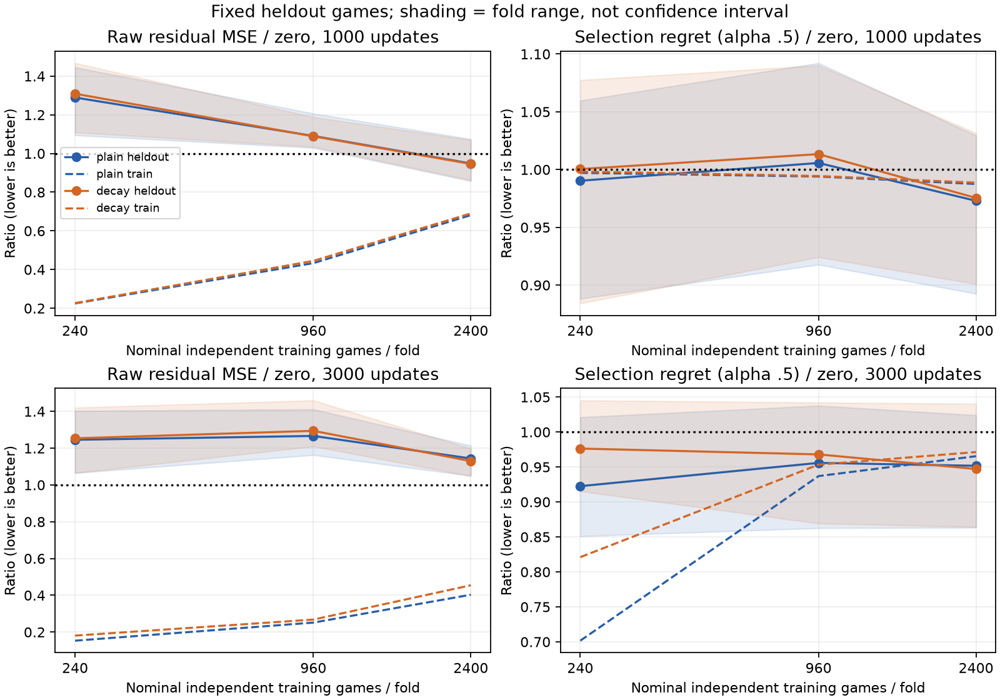

# 独立ゲーム数による補正学習曲線

**対戦gate未達。新validation対局・holdoutは生成せず、既存value/2ply推奨とmainを維持する。** 独立ゲーム数を増やすと平均の教師補正MSEは改善したが、候補選択損失の改善は分割をまたいで再現しなかった。教師は固定value・相手幅3のdepth4であり、真のゲーム価値ではない。

破線はtrain、実線は固定評価bank。帯はfold間の範囲でありCIではない。更新数を揃えたため、実効epoch数はデータ増加とともに減る。全モデルが収束した時点の比較ではない。

## データと比較条件

入れ子の源pool360/1440/3600ゲームを生成。相手random/heuristic/既存value6ms×先後を6ゲームblockで均等化し、block単位に3foldへ分割。各foldは自分以外のpool2/3で訓練する。別seedの固定評価bank360ゲームは、対応fold120ゲームずつを評価に使う。1ゲームから進行度45%/65%の最大2rootだけを採り、root数だけ増やした比較とは区別した。指定時点で候補2手未満のrootは除外する。

| 予定訓練ゲーム数/fold | rootを提供した訓練ゲーム数（fold0/1/2） | pool+bank源ゲーム累計 | 保存root累計 |
|---:|---:|---:|---:|
| 240 | 237 / 239 / 238 | 720 | 1,347 |
| 960 | 952 / 954 / 952 | 1,800 | 3,369 |
| 2400 | 2380 / 2388 / 2384 | 3,960 | 7,424 |

評価寄与ゲームは固定119/117/120、合計356ゲーム674root。源ゲームIDだけでなく完全手順のhashも3,960件すべて異なる。重複root15件をbank優先で除去し、各サイズのNPZは以前の配列を完全なprefixとして保持する。相手/座席/foldと進行度別実数はstrata-counts.json。旧holdoutを学習・選択へ転用していない。

同じCorrectionNet、masked Huber、lr0.001/batch32、AdamWのweight_decay=0 / 0.1の2条件のみ。対称変換は使わない。全盤面・候補特徴・固定value・応手policy・最終選択への補正接続はc46a180と同じ。初期重みseed1100を共有、更新seed1101/1102/1103はminibatch順だけを変更する。3サイズ×3fold×3seed×2条件=54run、各3000更新。gateは事前固定1000更新だけで判定し、3000更新は過適合診断に限定した。

## 固定評価bankでの学習曲線

下表は1000更新。ゲーム内のrootと更新seedを平均した。MSEは生の補正予測と教師depth4-depth2補正の差。選択損失は実戦と同じalpha0.5適用後の教師値regret（点）。未知教師値はmask、同値候補はどれを選んでもregret=0とする。

| 訓練予定ゲーム数 | weight decay | 評価MSE（zero 7.3043） | 評価選択損失（zero 0.53711） |
|---:|---:|---:|---:|
| 240 | 0 | 9.4184 | 0.53193 |
| 240 | 0.1 | 9.5620 | 0.53736 |
| 960 | 0 | 7.9665 | 0.54018 |
| 960 | 0.1 | 7.9543 | 0.54429 |
| 2400 | 0 | 6.9279 | 0.52259 |
| 2400 | 0.1 | 6.9091 | 0.52393 |

2400条件の平均MSEはzero比で約5.2–5.4%減、選択損失は約2.5–2.7%減。ただしゲームcluster bootstrapの改善量（zero−モデル）の95%CIは以下で、0を含む。

| 条件 | MSE改善量CI | 選択損失改善量CI |
|---|---:|---:|
| decay 0 | [−0.2361,+0.9323] | [−0.02464,+0.05399] |
| decay 0.1 | [−0.2012,+0.9364] | [−0.02637,+0.05263] |

2400/plainのfold0ではMSE/選択損失とも改善、fold1ではともに悪化、fold2ではMSEは改善するが選択損失は悪化。decay条件も同じ傾向で、全foldで5%以上改善する事前gateを通らない。更新seedをfold平均した選択損失はplain0.5181–0.5285、decay0.5230–0.5240であり、更新seed差より分割ごとの改善/悪化が問題だった。

CIは356ゲームをclusterとし、同じゲームの複数rootと3更新seedを先に平均する。学習済みモデルに条件付けた不確実性であり、初期重みや訓練集合の全分布を包含しない。foldの訓練集合は重なるため独立9標本と扱わない。個別値はcurve-*.jsonに保存。

3000更新ではtrain MSEは下がるが、2400の評価MSEは8.355/8.251へ悪化（zero7.304）。選択損失も0.5112/0.5087でCIは0を含む。長時間更新や小さい対戦validationの偶然の最大値で救済する根拠は得られなかった。

## 追加生成の例外と対戦停止

独自の追加生成gateは「240→960でMSE/選択損失とも非悪化、片方5%以上改善」で、両条件とも未達だった。失敗はextension-gate.jsonに保全した。

一方、依頼の早期打切り許可は「曲線が悪化のみ」であり、今回はMSEが15–17%改善していた。予算にも余裕があるため、2400を測る**生成だけの例外**を生成前にextension-exception.jsonとPROGRESSへ明示した。独自gateを厳しく置き過ぎた手続き上の例外であり、隠さない。

対戦gateは変更していない。最大サイズ・1000更新で「全foldのMSE/選択損失各5%以上改善」「全更新seedのfold平均選択損失改善」「ゲームCI下端が両指標とも正」を要求し、両モデルとも未達。decision.jsonはaccepted_conditions=[]、advance=false。新validation32prefixもfresh96prefix holdoutも作成していない。CLIもgate未達または曲線未完了時は対戦を拒否する。

## 選択偏り・入力情報の診断

層化したbank20ゲーム36rootで、代表seed1101/fold0の学生2条件、zero、既存教師、追加random候補を共通depth4で評価した。各学生の36選択中2件は元ラベル集合外であり、未知値をゼロ正解にせず追加評価した。

拡張共通候補集合内の平均regretはzero0.8222、plain0.7331、decay0.7151、元教師選択0.0232。元の教師選択も拡張集合の最善を常に含まないため、上位4＋random2のラベルには選択偏りが残る。特定fold/seedの小規模診断であり、全体gateの代用にも棋力改善の証拠にも使わない。

7,424root中1,037rootで別の合法手が同じ候補特徴になり、同じ入力なのに教師補正が異なるラベル群が59件あった。候補の要約特徴には明示的なorientation/セルmaskがなく、モデルは区別できない。ただし観測衝突から得られるMSE下限は0.000349と小さく、全誤差の主因とは断定できない。最大教師補正差は3.242点。具体例はinput-collisions.json。

次の小規模対照案は、教師・損失・探索を固定したまま候補の正確なセルmaskを入力へ通し、新しいゲームbankで同じ汎化gateを確認すること。今回の結果から大規模更新や対戦holdoutを再び増やす根拠はない。表現を変える場合も、今回のbankへの事後適合を成功判定に使わない。

## 計算量・検証・再現

主学習54run、162,000更新、GPU主学習176.53秒（評価/保存時間込み）。RTX5090、PyTorch2.7.1+cu128。データ生成増分合計1,286.20秒。全体はbranch作成から約40分で2時間/主学習30分以内。

85 tests PASS（7.54秒）。両optimizer条件のCUDA別process再開、shared初期重みhash一致。源3,960ゲームの全手順/終局、7,424rootの合法候補/入力/mask、3サイズの入れ子配列・分割hash、教師75rootと偏り診断36rootの値再計算、ゲームCI/gate算術を検証しPASS。実装担当の検証であり、秘書による独立監査とは呼ばない。

監査用NPZを繰り返し展開する非効率を見つけ、診断processを停止して一度だけ展開する方式へ修正した。学習・ラベル・選択は変えず、修正後に監査を完走した。

全runのconfig/source hash/model hash/ゲーム別損失を保存。各サイズ・条件の代表fold0/seed1101だけ1000/3000checkpointを保持し、大量複製を避けた。main変更なし、有限runは終了。

再開表記の訂正: 前報告の「40更新vs20+保存再開40」は、実ログでは **40更新連続 vs20更新＋保存再開後追加20更新（通算40）**。--steps 40は総目標40である。今回は前半20・追加20・総40を別フィールドで保存し、両optimizer条件ともmodel/optimizer/Python/NumPy/Torch/CUDA RNGのbit一致を確認した。

詳細な設計・再現は[METHOD.md](METHOD.md)。図の[SVG](learning-curves.svg)、数値curve-*.json、計算量compute-summary.json、検証audit.json/cuda-resume.jsonを参照。
