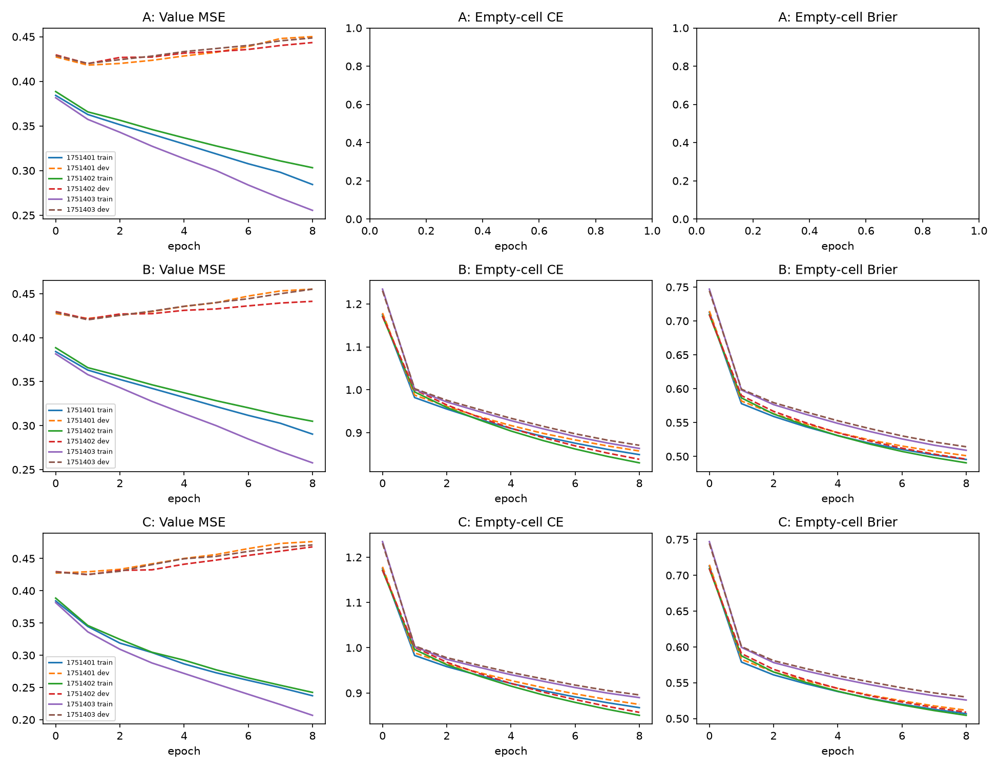
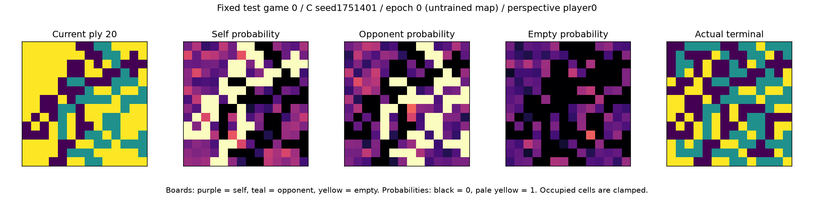

# Terminal occupancy prediction research

The fixed experiment did not establish superiority of feeding predicted terminal occupancy into value. All five multiplicity-adjusted intervals include 50%. C scores 48.18% against gen4, 51.04% against A and 51.82% against B. Public gen4 remains unchanged; this is not a deployment recommendation or evidence of a general learning ceiling.

## Design and provenance

Preregistered PLAN commit774fffb and pilot/final lock d9f3581 preceded main generation. Base main2529f5056419f70939366aa9fa105728ae4ad3bd. Three seeds1751401/1751402/1751403 are retained throughout. A is direct value; B adds empty-cell terminal occupancy auxiliary learning but never feeds predictions to value; C adds a learned projection of its 14×14×3 softmax to value while retaining original common features and252 mobility inputs. Shared conv/value features are trainable; original gen4 candidate policies remain fixed. No terminal labels enter inference. Known occupied cells are clamped to current ownership.

Teacher games are actual fixed gen4-search versus gen4-search, CPU500ms width4 maxdepth6, after random8/10/12-ply prefixes. No gen3 greedy substitution. Pilot12 games are excluded. Main train1536/dev192/test192 games are shared by every arm and seed, yielding38802/4858/4851 current positions. Game splits are fixed; no augmentation; new cross-split D4 canonical states and exact prior-used state exclusions are checked. Historical exclusions include prior research states/evaluation and original PPO index; old matches are not pooled. Historical exact hashes do not establish exhaustive D4 exclusion against all old datasets, unlike the canonical checks between new splits.

All9 models start from the corresponding gen4 value with identical new-head initialization within seed. Adam1e-4,batch128,8epochs,gradient clip1, value MSE of terminal score sign; B/C add0.25 empty-cell CE. Each model executes2432 optimizer updates, total21888. Training33.33s, peak CUDA244963328bytes. Main generation1989.60s with4workers; feature/split preparation243.50s. Evaluation is sequential and does not overlap generation/training/heavy audit.

## Fixed independent comparisons

64 new common prefixes ×2 seats ×3 seeds=384 games per comparison; total1920. Prefix-cluster bootstrap20000 draws, fixed seed924481. Ordinary95% intervals are descriptive;99% intervals apply Bonferroni across5 primary win-point comparisons (family95%). Prefixes, seeds and swapped seats are not treated as independent games for CI. Score intervals below are descriptive95%, not multiplicity-adjusted. No checkpoint changes, extra games or seed filtering followed independent results.

| Comparison | W/D/L | Win points % | Adjusted99% CI % | Mean score difference | Score95% CI |
|---|---|---:|---|---:|---|
| AG | 184/11/189 | 49.35 | 45.96–53.12 | -0.0182 | -0.4089–+0.3750 |
| BG | 177/13/194 | 47.79 | 43.88–51.69 | +0.1484 | -0.3333–+0.6432 |
| CG | 178/14/192 | 48.18 | 45.05–51.17 | -0.2031 | -0.6536–+0.2552 |
| CA | 190/12/182 | 51.04 | 48.31–53.91 | +0.1250 | -0.3646–+0.6146 |
| CB | 192/14/178 | 51.82 | 49.22–54.56 | +0.0026 | -0.4870–+0.4948 |

| Comparison | Seed1751401 % | Seed1751402 % | Seed1751403 % |
|---|---:|---:|---:|
| AG | 50.00 | 49.22 | 48.83 |
| BG | 47.27 | 51.17 | 44.92 |
| CG | 49.22 | 50.00 | 45.31 |
| CA | 49.22 | 53.52 | 50.39 |
| CB | 53.52 | 50.00 | 51.95 |

C did not satisfy the preregistered adoption criterion: adjusted superiority over G,A,B plus positive score differences. Point estimates against G are below50% for A/B/C, but corrected intervals also permit improvements. This finite test does not establish equivalence, impossibility, or a general ceiling. C/A and C/B separate the requested routes only within this architecture/training procedure: the additional gradient path and parameter count also differ.

## Checkpoint selection and diagnostic curves

Checkpoint selection used dev value MSE only, with epoch0 allowed and earliest ties. Train metrics were NOT logged during training. They were reconstructed after all independent games from saved checkpoints, without optimizer updates or reselection; dev curves are original selection logs. Full value and empty-cell CE/Brier/class/stage curves are in diagnostic-curves.json and selection.json. Brier is a proper probability score, not a stand-alone calibration decomposition.

| Model | Selected epoch | Train MSE epoch0/1/8 | Dev MSE epoch0/1/8 |
|---|---:|---|---|
| A-1751401 | 1 | 0.3843/0.3629/0.2844 | 0.4275/0.4182/0.4501 |
| B-1751401 | 1 | 0.3843/0.3632/0.2903 | 0.4275/0.4219/0.4553 |
| C-1751401 | 0 | 0.3843/0.3446/0.2372 | 0.4275/0.4294/0.4762 |
| A-1751402 | 1 | 0.3886/0.3658/0.3033 | 0.4297/0.4199/0.4435 |
| B-1751402 | 1 | 0.3886/0.3659/0.3050 | 0.4297/0.4213/0.4414 |
| C-1751402 | 1 | 0.3886/0.3461/0.2424 | 0.4297/0.4249/0.4681 |
| A-1751403 | 1 | 0.3816/0.3574/0.2555 | 0.4290/0.4200/0.4487 |
| B-1751403 | 1 | 0.3816/0.3580/0.2577 | 0.4290/0.4204/0.4552 |
| C-1751403 | 1 | 0.3816/0.3363/0.2068 | 0.4290/0.4253/0.4711 |

Observed: training value error decreases, whereas dev value error reaches its minimum at epoch0/1 and then increases. This is consistent with overfitting, but does not identify its cause. Competition between value and occupancy objectives is a hypothesis, not established causally; architecture capacity, labels, data size and loss weighting remain confounded.

C-1751401 selects epoch0. Saved tensors confirm all original gen4 shared/value weights are bit-identical, and map_value projection is exactly zero. The occupancy heads remain random initialized, so predicted maps have no contribution to value. On128 saved current positions, C and direct-value A with the same epoch0 tensors give bit-identical outputs. This seed does NOT demonstrate effective learned prediction use. Inference still computes the extra map, so wall-clock search may differ from gen4 despite equal value mathematics. C other seeds selectepoch1 with projection norms0.5025/0.4953; nonzero connection alone does not prove useful map reliance.

## Runtime and model size

All arms allocate139588 parameters for matched initialization scaffolding. Effective A value parameters72529; B training101956 but inference72529; C training/inference139588. Pilot CPU call times A0.0416/B0.0410/C0.0666ms are short pilot measurements, not definitive benchmarks. Timed search below is the practical cost. CUDA pilot timings were order/warmup affected and are not used for arm performance claims.

| Pair | Candidate mean/p95 ms | Control mean/p95 ms | Candidate/control depth6 % |
|---|---|---|---|
| AG | 174.00/399.91 | 172.63/397.35 | 86.55/86.72 |
| BG | 173.31/399.36 | 171.62/397.48 | 86.43/86.03 |
| CG | 196.19/457.89 | 170.78/397.93 | 84.44/86.36 |
| CA | 195.53/458.25 | 171.46/399.44 | 84.75/86.03 |
| CB | 195.60/458.11 | 171.59/399.81 | 84.32/86.00 |

Full timing counts, maximums, fallback counts and over550ms counts are in eval-*.json. Depth fractions include the recorded move population and fallback moves. Independent comparison wall time totals150.03min.

## Fixed examples and preservation

Heatmaps use preregistered testgame0 at plies8/20/28 and Cseed1751401, not a best-case search. Because this seed selects epoch0, these are untrained occupancy-head examples and must not be presented as learned forecasts. Probability maps, current-empty masks and actual terminal boards are saved in heatmap-examples.json. Colors for self/opponent/empty correspond to current-player perspective; each probability panel has scale0–1.

All81 epoch checkpoints include model/Adam/CPU-CUDA-shuffle RNG;9 selected CPU exports are directly versioned. Raw teacher games, independent games, labels/features and historical/new exclusion sets are preserved in5 bounded archive parts. archive-manifest.json records3941 member SHA256 hashes and part hashes; every archived member was content-verified. `python scripts/future_restore.py` concatenates and verifies parts, extracts safely, and verifies every member. No generation or training is needed for restoration.

CPU verification used a separate clean clone of a90e5e3 with CUDA hidden, reusing the existing Python environment. Native build and4 tests passed; research CLI Cseed1751402 completed a coordinate-replay-verified legal game with scores-11/-23. All3941 archive members restored successfully. This is a clean-source/CPU validation, not an independently provisioned dependency environment. The research CLI does not modify public Web routing.

Full independent coordinate replay and feature/label/exclusion audit passed: 1932 teacher/pilot games and 1920 independent games, 48734 evaluation states, zero detected leakage hits; all nine optimizer counts and dev selections verified. Audit took 4030.3s; repeated compressed-array decompression made this verification slow. All 18 arm/seed/device restoration checks passed in separate processes (same-device exact loss/tensor agreement after restoring optimizer/RNG); CPU/CUDA cross-device bit equivalence is not claimed. Four post-run tests passed. Evidence: audit.json, resume-audit.json, post-tests.json and clean-cpu.json.

## Held-out prediction metrics

These descriptive metrics were computed only after selection and independent matches, on 192 held-out teacher games (4851 positions). Value MSE is game-weighted; occupancy metrics pool currently empty cells (472327 cell observations), not known occupied cells. Repeated positions/cells are not independent trials; no inference CI is claimed here. A has no trained occupancy objective.

| Model | Value MSE | Empty CE | Empty Brier |
|---|---:|---:|---:|
| A-1751401 | 0.43317 | — | — |
| B-1751401 | 0.42926 | 0.98698 | 0.58177 |
| C-1751401 | 0.43336 | 1.17302 | 0.71149 |
| A-1751402 | 0.42481 | — | — |
| B-1751402 | 0.42504 | 1.00135 | 0.59079 |
| C-1751402 | 0.43355 | 1.00254 | 0.59176 |
| A-1751403 | 0.42705 | — | — |
| B-1751403 | 0.42729 | 1.00446 | 0.60062 |
| C-1751403 | 0.43202 | 1.00616 | 0.60190 |

Per-class and stage metrics below average the three seed metrics equally, including C’s untrained selected seed. Classes condition on actual terminal ownership; stages are ply <12, 12–23, ≥24. Full seed×stage×class counts, CE/Brier and descriptive accuracy are in test-metrics.json.

| Arm | Group | CE | Brier |
|---|---|---:|---:|
| B | actual self | 1.52794 | 0.97791 |
| B | actual opponent | 1.65941 | 1.02789 |
| B | actual empty | 0.62334 | 0.33184 |
| B | ply <12 | 1.21023 | 0.73795 |
| B | ply 12–23 | 1.05481 | 0.62966 |
| B | ply ≥24 | 0.81477 | 0.46638 |
| C | actual self | 1.35407 | 0.85439 |
| C | actual opponent | 1.51365 | 0.93147 |
| C | actual empty | 0.82742 | 0.47345 |
| C | ply <12 | 1.20108 | 0.73093 |
| C | ply 12–23 | 1.09818 | 0.66001 |
| C | ply ≥24 | 0.94013 | 0.55409 |

The trained heads tend to predict terminal empty cells much better than future self/opponent occupation. This class imbalance and the weak early selected checkpoints limit any claim that useful terminal structure was learned. Neither aggregate cell accuracy nor value MSE establishes playing strength.
