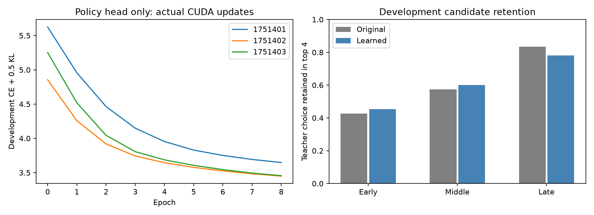
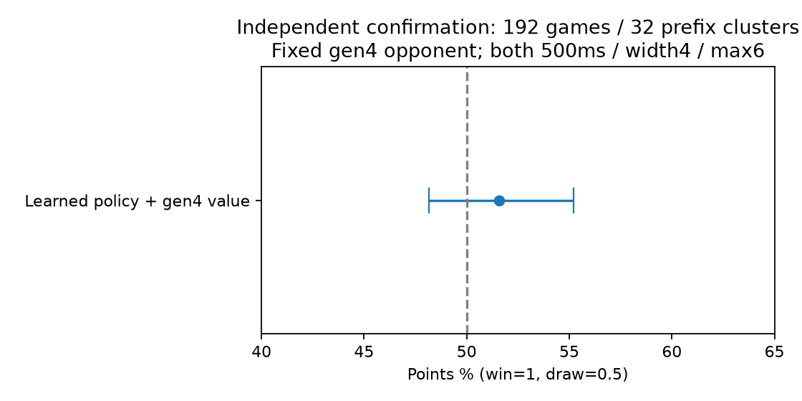

# gen4候補方策の初回学習: 改善未確認・不採用

新しい768ゲームの3,920局面から、固定gen4価値を使ったroot12/内部幅4/完成6ply探索の候補順位を教師に、元gen3の方策headだけをCUDA更新した。勝敗からの追加強化学習ではなく探索蒸留。価値・共有trunkは凍結。全3seed各8epoch、640/664/664更新（合計1,968）、実学習9.48秒。新dev96ゲーム500局面の目的関数平均のみで共通epoch8を選択。

## 事前計画と診断

PLANを本試験前に2a5e58eで固定。診断48ゲーム244局面で、広幅選択が旧top4外103/244 (42.21%)、4/6plyで同じ範囲外手44/244 (18.03%)、全3seedに存在し事前gate通過。rootだけ拡幅、内部候補/価値/深さを共通化。共通root値は全件exact一致。狭幅の候補脱落は存在するが、広幅の予測順位が実WDLを改善するとは証明していない。6候補局面/ゲームは相関し、game_clustersを保存。

| 層 (ply) | 局面 | 範囲外 | 深さ間安定の範囲外 |
|---|---:|---:|---:|
| 序盤12/13 | 96 | 57.29% | 22.92% |
| 中盤20/21 | 94 | 39.36% | 15.96% |
| 終盤28/29 | 54 | 20.37% | 12.96% |

## 対戦 (固定3seed・先後交換)

| 比較 | 局数 | 勝/分/敗 | 勝点 | prefix95%CI | 得点差 [95%CI] |
|---|---:|---|---:|---|---|
| 選択用: 新H/固定gen4 H | 96 | 51/2/43 | 54.17% | 50.52%–58.33% | +0.490 [-0.406, +1.385] |
| 補助: 方策単体/元方策 | 96 | 45/2/49 | 47.92% | 42.71%–53.12% | -1.635 [-2.729, -0.635] |
| 独立確認: 新H/固定gen4 H | 192 | 95/8/89 | 51.56% | 48.18%–55.21% | -0.120 [-1.000, +0.661] |

独立確認は未使用32prefix×2席×3seed。選択用16prefixは合算していない。事前主比較は一つで95%prefixクラスタbootstrap (20,000回)。seed一般化ではなく固定3seedについての推論。点推定51.56%だがCI下限50%未満、得点差も負なので採用gate未達。同等性や悪化確定とは言わない。人間への強さ未検証。

| 固定seed / 新方策の席 | 勝点 | 得点差 |
|---|---:|---:|
| seed 1751401 | 57.81% | -0.141 |
| seed 1751402 | 52.34% | +0.328 |
| seed 1751403 | 44.53% | -0.547 |
| seat 0 | 69.79% | +4.229 |
| seat 1 | 33.33% | -4.469 |

## 診断改善と限界

- 序盤dev教師手top4保持率: 42.71% → 45.31% (+2.60pp)。
- 中盤dev教師手top4保持率: 57.49% → 60.13% (+2.64pp)。
- 終盤dev教師手top4保持率: 83.47% → 78.17% (-5.30pp)。

中盤指標は小幅改善したが、終盤は退行。単体の得点差も負。候補順位学習で開発lossは下がったが、最終勝点改善とはならなかった。教師の価値誤差、候補の多様性減少、教師生成分布とH対戦分布の違いは残る仮説で、この試験では原因を確定できない。広い候補脱落仮説自体は棄却されていないが、今回のsoft順位head学習を採用する根拠はない。
教師生成はrandom8ply＋元gen3 greedy継続で採集した局面であり、gen4 H自己対戦分布ではない。教師はroot12外を依然見ない。探索値は終局勝敗教師/minimax真値ではない。gen4教師での実終局value学習を次に行うなら別事前計画・対照が必要で、この陰性結果だけから成功を予測しない。今回の追加救済条件は実施していない。

## 時間・完成深さ

| 独立確認 | 平均ms | p95ms | 最大ms | 深さ6完了率 | >550ms | fallback |
|---|---:|---:|---:|---:|---:|---:|
| candidate | 201.68 | 401.70 | 558.98 | 99.43% | 0.05% | 0 |
| frozen | 201.14 | 415.31 | 500.38 | 99.29% | 0.00% | 0 |

両者CPU幅4/max6/500ms上限、同実wallを保証する比較ではない。候補最大558.98msでハード時間保証なし。cold/warmupは*-time.jsonに別保存。生成/学習と時間対戦は非並行、生成4CPUworker。既存async512はroot12＋独立配置価値の教師経路にそのまま対応しないため無理に変更せず、GPUは実学習に使用した。

- diagnosis教師生成wall: 59.06秒。
- train教師生成wall: 626.00秒。
- dev教師生成wall: 80.47秒。
- validation対戦wall: 450.78秒（cold/warmupは同JSON）。
- confirmation対戦wall: 876.58秒（cold/warmupは同JSON）。

## 保存・監査

全新診断/訓練/dev/対戦の棋譜・完成木ラベルを保存。独立座標ルールreplayで合法性/終局得点を確認。元PPO訓練index・過去評価/速度/新生成状態との分離、集計再計算、モデルhash、実Adam更新数、各epoch凍結tensor、別process CPU/CUDA各同device次更新一致を確認。CPU/CUDA bit同値の主張はしない。新評価に人間棋譜は使用しない。原始棋譜はraw-games.tar.gzから復元でき、全epoch optimizer/RNGと3seed推論exportを保存。
CPU CLI対局・関連4tests通過。別のクリーンsparse checkoutでもCUDA_VISIBLE_DEVICESを空にしてnativeを新規build、同4testsとCPU対局完走。既存venvを共用し、新しい依存インストールまでは行っていない。初回checkout検証はnative未build/旧比較fixtureのsparse範囲不足で失敗し、文書通りbuildとfixture追加で解消。モデル選別なし、公開gen4/タグ/main/Webを変更していない。

## 再現

```bash
export PYTHONPATH=.:scripts OMP_NUM_THREADS=1 OPENBLAS_NUM_THREADS=1
tar -xzf artifacts/gen4-candidate-policy/raw-games.tar.gz -C artifacts/gen4-candidate-policy
python -m blokus.ppo_native build
python scripts/candidate_audit.py
python scripts/candidate_resume_check.py
python scripts/candidate_report.py
python scripts/candidate_play.py --policy artifacts/gen4-candidate-policy/policy-1751401.pt --human-seat 0
```

監査の元訓練indexは既存 /tmp/ppo-lr64-training.npy (bank-manifest SHA固定) が必要。歴史状態再照合にはローカルexcluded-states.json.gz/旧研究アーカイブが必要でGitには巨大再構築集合を含めない。推論CLIはこれら不要。CPU導入はFROZEN_GEN4.mdの手順、学習のみCUDA必要。選択済export metadataのvalue SHAを検証して固定gen4価値と組み合わせる。
再学習は完成checkpointを別保存し、空の新出力先へ同bankを置いてcandidate_train.py。既存出力への実行は保存epochを再利用する仕様で、追加学習とは呼ばない。評価再実行では時間制限により着手差が生じ得る。完全同一固定木の検証と時間制限対戦再現を区別する。



