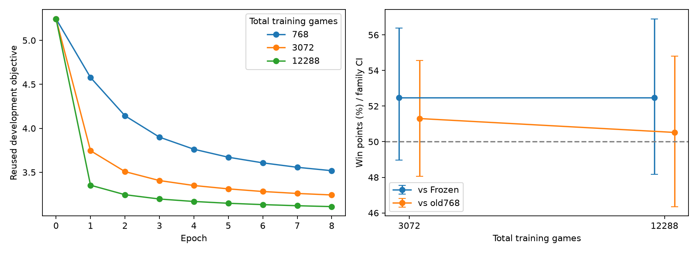
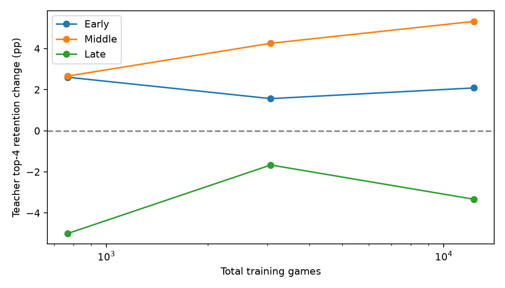

# 候補方策の学習量増量: 768 → 3072 → 12288局

## 結論

固定した新規1,536対局では、3,072局版・12,288局版とも事前の優越条件（両対照への多重比較補正勝点CI下限>50%、平均得点差>0）を満たさなかった。棋力改善は未確定で、公開採用しない。12,288局まで増やしても、この条件・標本で勝点の伸びを確認できなかった。一般的な学習の頭打ち、同等性、成功確率は推定しない。

|総train局数（各seed）|対照|勝/分/敗|勝点|4比較補正CI|平均得点差|
|---|---|---|---|---|---|
|3072（1024）|固定gen4|195/13/176|52.47%|48.96–56.38%|+0.297|
|3072（1024）|旧768候補|189/16/179|51.30%|48.05–54.56%|+0.250|
|12288（4096）|固定gen4|193/17/174|52.47%|48.18–56.90%|+0.706|
|12288（4096）|旧768候補|183/22/179|50.52%|46.35–54.82%|+0.625|

各384局=64新prefix×先後交換×全3seed。補正区間はprefix-cluster bootstrap 20,000回、Bonferroni98.75%区間（4比較のfamily95%）。seed/先後別値、通常95%区間、探索時間と深度は各summary JSONに保存。得点差は副指標であり、勝点の優越不成立を覆す採用判定には使わない。

共通prefixによる12288−3072のpaired勝点差は、対gen4 **0.00pp、記述的95%CI −3.26〜+3.13pp**、対旧768 **−0.78pp、−4.30〜+2.86pp**。点推定では後者が下がったが、増量による悪化も確定していない。全3seedを残し、途中成績による中止・標本追加・再選択は実施していない。

旧768の以前の独立192局51.56%（CI48.18–55.21%）は別prefix・別実験であり、新成績に合算しない。今回の旧768は固定epoch8の対照として使った。

## 学習曲線と固定条件

旧768=各256局を変更せず再利用し、新規11520局のみ追加生成。3072と12288は入れ子で、各段階は元のgen3方策（Frozen gen4の方策成分）から独立に初期化。直前の学生重みから継続していない。gen4配置価値と方策の非policy部分を固定し、root12/内部幅4/完成6ply教師、CE+0.5KL、Adam1e-4、batch16、float32CUDA、8epoch、全seed1751401/2/3を維持した。

|総train局数|訓練局面数|実Adam更新数|共通選択epoch|平均dev目的|CUDA学習wall|
|---|---:|---:|---:|---:|---:|
|768（既存）|3920|1968|8|3.51824|9.48秒（以前）|
|3072|15740|7872|8|3.24223|34.49秒|
|12288|62674|31344|8|3.10979|135.26秒|

今回の実更新合計39216、学習wall169.75秒。量を増やすと固定8epochで更新回数も増えるので、**データ量と比例した更新予算を合わせた比較**であり、等更新数の純粋なデータ効果ではない。旧96局devは以前の選択で既使用と明記し、全段階共通に再利用した。独立評価は新prefixで分離し、dev目的の全seed平均のみで共通epochを選んだ。



序中終盤の教師top4保持率と元top4/greedy候補の脱落数はproxy-curve.json、各段階dev-turnover.jsonに保存。これらは既使用dev上の代理指標で、棋力ではない。「既存候補脱落」は既知の正解手の脱落を意味しない。



## 費用と評価環境

新教師生成は2304局1884.50秒＋9216局7430.20秒=9314.70秒（約155.25分）、既存4CPUworker。新速度benchmarkや非対応async512への切替は実施しない。独立対戦は計7412.56秒（約123.54分、warmup別保存）。生成・学習・重い監査をCPU時間対戦に重ねず、対戦終了後に監査と圧縮を開始した。

両者CPU500ms上限、幅4/max6、同gen4価値、先後交換。実際の探索時間は手ごとに異なり、同wallを保証する実験ではない。時間制限による再現時の着手差はあり得る。最大時間・550ms超過数・完成6ply率・fallbackを各summaryに保存。4比較いずれも全標本を完了した。

## 保存・再現

raw-1751401/2/3.tar.gzには新11520ゲームのsource棋譜と完成教師ラベル、evaluation-games.tar.gzには1536対局の全棋譜・探索統計を保存。圧縮後に各メンバーの内容SHAを原本と照合済み。archive-manifest.jsonは個数/サイズ/アーカイブSHAを記録。全6推論exportと各seed全epoch0..8のモデル/Adam/RNG、全曲線・bank・選択・集計を保存した。旧768とdevは旧アーカイブから復元して入れ子リンクを再構成できる。歴史状態の除外集合も40MiB以下の分割ファイルとSHA付きで保存した。

```bash
export PYTHONPATH=.:scripts OMP_NUM_THREADS=1 OPENBLAS_NUM_THREADS=1
python scripts/candidate_scale_restore.py
python -m blokus.ppo_native build
python scripts/candidate_scale_audit.py
python scripts/candidate_scale_report.py
CUDA_VISIBLE_DEVICES='' python scripts/candidate_play.py --policy artifacts/gen4-candidate-scale/n12288/policy-1751401.pt --human-seat 0
```

監査には既存PPO訓練index（bank生成時SHA固定）と旧研究資産が必要。推論CLIには巨大indexや教師アーカイブは不要。クリーンcheckoutは別working treeの共有object cloneから実施し、既存venvを再利用。CUDA_VISIBLE_DEVICESを空にしてnativeを新規build、関連4tests通過、12288候補のCPU CLI合法対局を完走した（これは棋力証拠ではない）。依存をゼロから再導入した検証ではない。

公開main、Frozenタグ、公開gen4モデル/Web、人間棋譜は変更せず、本PRもmergeしない。
