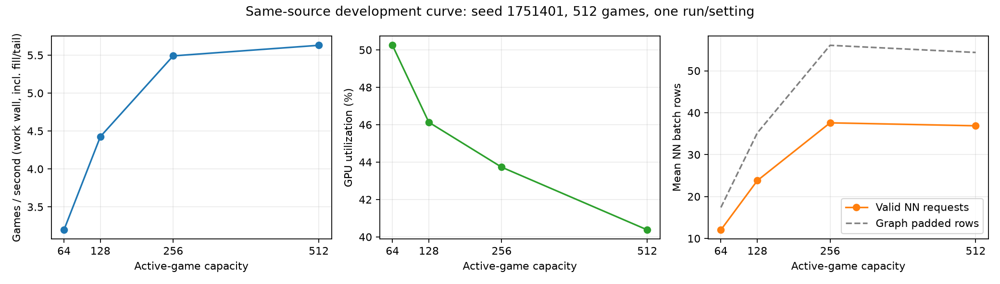
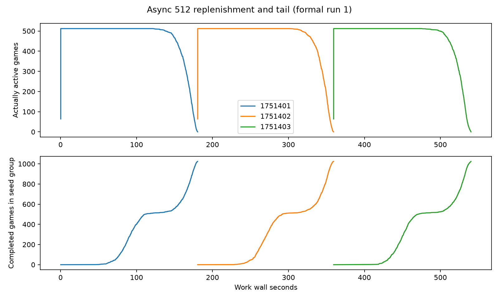
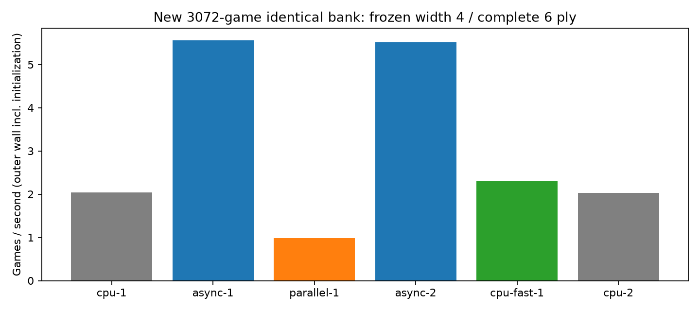
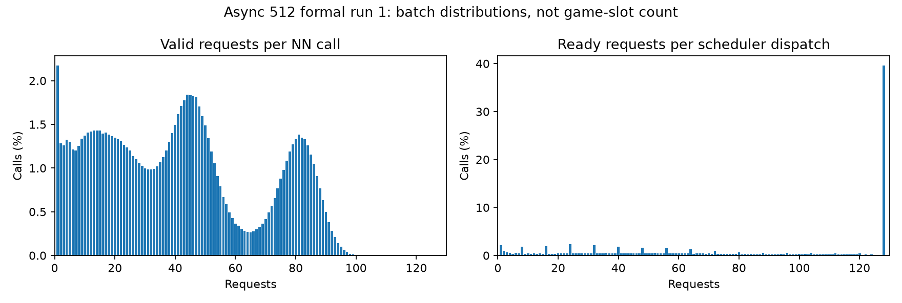
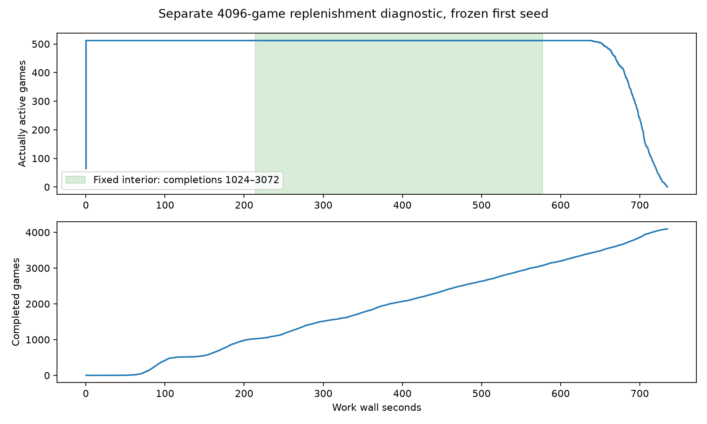

# 結果の要点

512対局を補充し続ける非同期GPU生成は、事前の速度・品質gateを通過。同一の新3,072局、固定3seed、幅4・完成6plyで、初期化込みCPU8比は 2.724倍 / 2.719倍でした。これは生成の高速化で、棋力改善の結果ではありません。

新方式は 5.560 / 5.510 games/s。CPU入力・copy削減だけの対照は 2.305 games/s（1回）でした。新方式はCPU探索8workerに調整役1コアを追加するため、総CPU資源が完全に等しいという主張ではありません。

main・Frozen gen3・公開Webは変更なし。新規研究モデルの学習は行っていません。同期RPCと64-cohort方式の不採用記録は保持しています。

# Async GPU self-play generation

Frozen width4 / completed6ply, new3072-game bank, three fixed seeds. Speed gate: **True**. No learning or strength evaluation was performed.

|Condition|Work s|Outer s incl. init|Games/s outer|GPU mean %|Mean actual batch|
|---|---:|---:|---:|---:|---:|
|cpu-1|1498.31|1505.18|2.041|0.1|CPU singleton|
|async-1|543.41|552.54|5.560|45.6|41.13|
|parallel-1|3106.16|3108.91|0.988|10.5|25.56|
|async-2|548.16|557.51|5.510|45.4|40.79|
|cpu-fast-1|1325.80|1332.50|2.305|1.4|CPU singleton|
|cpu-2|1508.65|1515.72|2.027|1.1|CPU singleton|

Matched initialization-inclusive CPU8/async ratios: 2.724x and 2.719x. CPU-fast is a separate one-repeat control to expose CPU encoding/copy savings; the whole ratio is not attributed solely to GPU kernels.

All throughput starts after fixed random8ply prefixes. Bank preparation is outside the identical measured scope; outer measurement includes Python startup, shared-buffer allocation, worker/model initialization, graph capture, full generation and shutdown. Work wall alone is also retained. GPU physical memory includes desktop/context; allocated peak is separately logged. These are generation timings, not human-play deadlines or strength improvements.

## Correctness

- cpu-1: 3072 complete games; 74238/74238 nonpass moves completed6ply; 3072/3072 full trajectories equal CPU1; same-state action agreement 100.000000%; max index-wise root difference (candidate mapping unverified) 0; nodes 76,941,263.
- async-1: 3072 complete games; 74230/74230 nonpass moves completed6ply; 3007/3072 full trajectories equal CPU1; same-state action agreement 99.922256%; max index-wise root difference (candidate mapping unverified) 0.0343; nodes 76,963,369.
- parallel-1: 3072 complete games; 74236/74236 nonpass moves completed6ply; 3038/3072 full trajectories equal CPU1; same-state action agreement 99.959497%; max index-wise root difference (candidate mapping unverified) 0.0343; nodes 76,950,341.
- async-2: 3072 complete games; 74243/74243 nonpass moves completed6ply; 3013/3072 full trajectories equal CPU1; same-state action agreement 99.929542%; max index-wise root difference (candidate mapping unverified) 0.0343; nodes 76,969,360.
- cpu-fast-1: 3072 complete games; 74238/74238 nonpass moves completed6ply; 3072/3072 full trajectories equal CPU1; same-state action agreement 100.000000%; max index-wise root difference (candidate mapping unverified) 0; nodes 76,941,263.
- cpu-2: 3072 complete games; 74238/74238 nonpass moves completed6ply; 3072/3072 full trajectories equal CPU1; same-state action agreement 100.000000%; max index-wise root difference (candidate mapping unverified) 0; nodes 76,941,263.

All saved games undergo independent coordinate legality/score replay. Forced pass is distinguished from fallback. Differences and root scores are retained in `final/audit.json`; float32 shape-dependent ties and alpha-beta node differences are not called bit-identical. CPU singleton optimized encoding/copy agrees exactly with the original tree and RNG. Per-NN CPU/CUDA graph tests use the predeclared2e-5 absolute tolerance.

## Structure and limitations

Eight CPU workers own independent suspended game slots;512 slots are replenished within each frozen-seed group. Shared arrays carry observations/results, bounded request IDs carry metadata, and the server dispatches arrival-ready requests without a full-cohort barrier. Up to8 descriptors are coalesced; CUDA graph buckets reuse pinned buffers. Search order, TT bounds and complete-stage selection are retained. No speculative sibling work is used.

GPU batch size is distinct from active games and limited to128 here. Padding, coordinator dispatch, CPU legality/encoding and finite tails remain. Graph capture cost, shape counts, queue waits, occupancy and CPU process times are saved.256/512 curve proximity is not proof that512 is universally optimal;1024 was not tested. No resource exclusivity was asserted and no other services were stopped.

Game-boundary restart retains completed files and restarts incomplete games from saved independent RNG. It does not serialize DFS stacks, and changed batch shapes can change floating-point tie decisions. Public CPU fallback and Frozen gen3 exports remain unchanged.

Previous synchronous RPC and64-frontier failure records are retained. The approximately12.5s/24 and25min/3072 historical numbers have different banks, scopes and deadline policies; no speed ratio is inferred from them. Formal comparisons use the same new bank and complete6ply.

## Reproduction

See `README.md`, `PLAN.md`, `final/measurement-manifest.json`, `scripts/run_async_final.py`, `scripts/audit_async_parallel.py`, and the archived full trajectories. No main merge/deployment, Frozen tag/model replacement or additional model training is part of this change.

## 追加の検証と再開

- 全正式18,432棋譜コピーを独立合法性・終局得点・完成段階・状態分離監査（3,072の共通taskを6条件で生成）。追加の開発/再開 5,216棋譜コピーも独立再生。旧bankを独立標本として合算しません。
- 中断再開: 完了済み1棋譜の元bytes/SHAを保持し、未完23局だけ再生成。生きたDFS stackの保存ではありません。
- 履歴を含めないクリーンGit archive f29e87050f54231dd5dbf866a245b2173f02322c でnative build、Frozen SHA、既存3072A/公開gen3 CPU export、全tests、gen3全3seed CPU対戦完走。CUDA非表示の同じcu128 wheelであり、別CPU-only wheelの新規インストールとは呼びません。詳細はclean-*.log。
- pytestには小さな更新回帰テストが含まれますが、新しい研究モデルの学習・選択はしていません。

|条件|CPUと全棋譜一致|最終得点一致|最終WDL一致|通常fallback|強制pass|
|---|---:|---:|---:|---:|---:|
|cpu-1|3072/3072|3072/3072|3072/3072|0|10030|
|async-1|3007/3072|3056/3072|3068/3072|0|10031|
|parallel-1|3038/3072|3066/3072|3069/3072|0|10034|
|async-2|3013/3072|3057/3072|3069/3072|0|10029|
|cpu-fast-1|3072/3072|3072/3072|3072/3072|0|10030|
|cpu-2|3072/3072|3072/3072|3072/3072|0|10030|

GPU2反復同士の全棋譜一致は 2972/3072。各ゲームのRNGは独立ですが、到着順で変わるbatch shapeとfloat32の同点近傍の判断により、生成全体のbit一致は保証しません。CPU2反復は 3072/3072一致。差分例・root配列はaudit.jsonに保存。

## 同一ソースの並列数曲線

以下は開発用512局・1seed・各1回。立ち上がりとtailを含み、特に512設定には追加の補充taskがありません。正式試験は1seedあたり1024局で512稼働の補充を検証しています。曲線だけから普遍的最適並列数を断定しません。

|同時対局容量|生成区間games/s|初期化込みgames/s|GPU利用平均%|有効NN batch平均|CUDA allocated peak MiB|
|---:|---:|---:|---:|---:|---:|
|64|3.197|3.040|50.2|12.05|972.2|
|128|4.427|4.133|46.1|23.80|1132.0|
|256|5.491|5.042|43.7|37.59|1228.1|
|512|5.630|5.146|40.4|36.89|1165.0|

## 残る費用と推奨範囲

- async-1: GPU利用平均45.6%、有効batch平均41.13、候補padding 6.19倍、graph capture 12.98s、H2D転送量2.737TB。CPU worker合計3840.5 CPU-s、調整役537.6 CPU-s。これら並行費用をwallへ単純加算しません。
  - seed1751401: 実際の512稼働区間123.3s、その区間の完局率4.161 games/s（有限区間の記述値）。
  - seed1751402: 実際の512稼働区間125.6s、その区間の完局率4.084 games/s（有限区間の記述値）。
  - seed1751403: 実際の512稼働区間117.4s、その区間の完局率4.351 games/s（有限区間の記述値）。
- async-2: GPU利用平均45.4%、有効batch平均40.79、候補padding 6.18倍、graph capture 12.99s、H2D転送量2.731TB。CPU worker合計3898.2 CPU-s、調整役542.7 CPU-s。これら並行費用をwallへ単純加算しません。
  - seed1751401: 実際の512稼働区間124.3s、その区間の完局率4.118 games/s（有限区間の記述値）。
  - seed1751402: 実際の512稼働区間125.0s、その区間の完局率4.105 games/s（有限区間の記述値）。
  - seed1751403: 実際の512稼働区間119.7s、その区間の完局率4.270 games/s（有限区間の記述値）。

共有slotは512設定で約360.5MiB（1実体）。process RSSの合算は共有ページを重複計上するため物理RAM量とは呼びません。GPU memoryはCUDA allocated peakとdevice全体の観測値を分けて保存。候補padding/転送、CPU探索・観測生成、調整役dispatchが残る費用です。将来の有効候補のみの転送やpack削減は仮説で、今回の未測定倍率は約束しません。

精度環境: float32 tensor、matmul TF32=False、cuDNN TF32=True。AMPなし。CPU/CUDAの許容差2e-5を検証。profilerは速度測定の後に別実行し、profile-eager/graphのoperator表・traceを保存しました。

再利用候補は、このRTX5090環境・固定gen3/4ch/native・8CPU worker＋GPU調整役・512 slots・batch上限128・fast encoding＋CUDA graphです。1024は未測定。512があらゆる局面分布で最適とは主張しません。新しい訓練bankは過去の評価・訓練との分離と独立game RNGを維持して別途固定し、この確認bankを訓練へ転用しないでください。

実行手順はREADME.md。mainへmerge/deployは行わず、研究用の生成候補として返します。

## 数値差の具体例と検証ハーネスの修正

1751401-845のply16でroot配列の差0.03433を検出しました。対入力診断ではNN logit差は最大6.68e-06、value差は4.77e-07ですが、内部局面のCPUで同値の4位/5位がGPUで入れ替わり、幅4の候補集合が変化しました。CPU順位を固定してGPU valueだけ使う診断では元着手に一致し、全root差は最大2.98e-07でした。これは1例での離散的増幅の説明で、全GPU実行をbit同等とする根拠ではありません。診断用の順位固定は測定した生成実装に採用していません。

初回CPUクリーン検証は、検証snapshotへ旧回帰テスト用の小さな2fixtureを含め忘れたため3件失敗しました。clean-first-attemptにログを保持し、snapshot対象を修正して再実施。探索/推論実装や測定データは変更していません。最終結果は123 passed / 6 skipped。GPUは別途正式生成・数値probe・再開で検証しています。

## 別の4,096局による補充区間の確認

追加で事前固定したseed1751401の新4,096局を1回実行。初期化込み747.42s / 5.480 games/s。完局1,024→3,072の固定内部区間では実稼働512〜512局、363.06s / 5.641 games/sでした。256完局ごとの変動はsteady-summary.jsonに保存。この補充診断には対応CPU測定がないため、新たな速度倍率を算出せず、元の正式比較に合算しません。全4,096棋譜を独立再生・状態分離監査しています。

bank復元の専用回帰テスト3件を追加。圧縮bankを元のcanonical JSON bytesへ復元し、既存の異なる出力を上書きしないことを検証。対応するSHA照合はbank-materialization-check.json。調整役CPU時間には待機・pollも含まれ、有効なpack計算だけとは扱いません。
