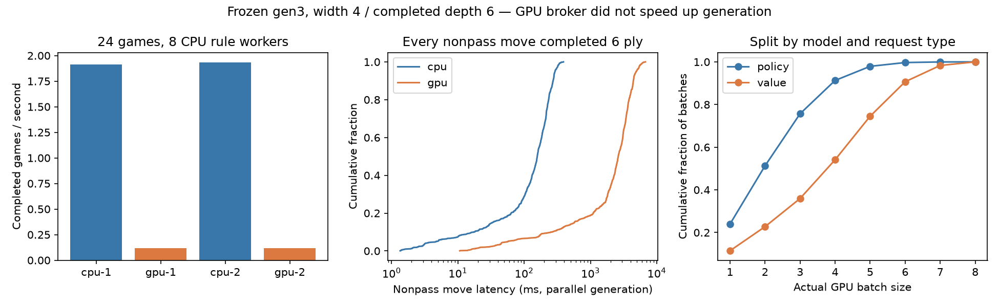

# GPUバッチ自己対戦生成：実装と有限比較

**今回の同期型GPU集約方式は不採用です。高速化を確認できず、追加大規模生成・学習・棋力評価には進んでいません。** GPUを使う生成経路は実装しましたが、CPU8workerより約16倍遅くなりました。GPU一般の限界ではなく、今回の小さな探索NNと同期RPC設計の結果です。

main・Frozen gen3のモデル/タグ・公開Webは未変更です。既存の3,072局A候補と6,144局の未達結果もそのまま保持しています。今回、新しい学習モデルや棋力改善はありません。

## 固定条件と実装

[事前PLAN](PLAN.md)をcommit `aa5e6b3` で保存。3つのFrozen gen3それぞれ8局、計24の新規ランダム8ply開始局面を固定しました。両者とも同じ固定教師で、幅4、深さ2→4→6の既存alpha-beta/TT探索です。60秒は異常停止用の上限で、非passの全着手について6ply完成をassertしています。過去の500ms生成時間を速度対照に流用していません。

CPUルール/native合法手・特徴生成を8processに残し、policyと葉valueのNN要求を中央のCUDAサーバへ送ります。モデルはGPU常駐。最大32、収集窓1msで、モデルseedとpolicy/value種別ごとにまとめて推論します。各workerは一度に1要求だけ待つ方式で、今回の8workerでは実際には最大8です。推論結果以外のゲーム進行・乱数・手順選択はサーバへ移していません。

最初の配線ではcustom value evaluatorを使い、同一モデルなのにpolicy/valueキャッシュ共有を無効にしていました。`pilot-v0/` にその全結果を残し、専用のvalue transportへ修正しました。同一CPU値を使ったテストでキャッシュ/node数/完成木一致を確認し、正式な4回の計測をやり直しています。幅、深さ、モデル、バッチ上限、gateの救済変更はありません。

## 同一bank・交互反復の実測

Ryzen 9 9950X3D、RTX5090、PyTorch2.7.1+cu128、float32、各worker torch1thread/core0〜7。GPU方式は加えて中央サーバCPUを使います。初期化と単体warmupを除外し、CPU→GPU→GPU→CPUの順に測定しました。学習・重い監査は重ねていません。新しいバッチshapeの初回費用は生成時間に含まれます。compile/graphは使っていません。

|反復|CPU8：24局|GPU集約：24局|CPU games/s|GPU games/s|GPU速度比 CPU秒/GPU秒|
|---|---:|---:|---:|---:|---:|
|1|12.55秒|200.63秒|1.912|0.120|0.0626倍|
|2|12.41秒|200.75秒|1.934|0.120|0.0618倍|

初期化はCPU0.91/0.93秒、GPU1.40/1.42秒。全反復で各24局を完走し、非pass574着手は全て6ply完成、未完値・浅い探索を速度向上に利用していません。強制passはdepth0で、失敗fallbackとは区別します。固定完了条件での生成比較であり、人間対戦500ms上限の評価ではありません。

## 費用と原因

[metrics.json](metrics.json)と各run JSONに分離して保存しています。以下は1回目（2回目も同傾向）。

- 約56.5万NN要求、実バッチ平均3.38。policyとvalue、3つのモデルへ分割されるため、設定上限32を埋められていません。policy候補paddingは実候補の1.50倍。
- GPU使用率の1秒サンプル平均7.23%、最大10%。監視には初期化も含みます。PyTorch peak allocationは38.93MiB、物理GPUメモリ最大1,166MiBはCUDA context・既存表示等も含む値です。
- CUDA event区間のforward累計54.31秒、pack/H2D区間19.57秒、サーバ処理wall累計86.74秒。event区間にはdispatch間の空きも含まれ、純kernel時間とは呼びません。D2H同期・応答処理はサーバwallに含まれ、個別分離していません。
- worker応答待ちは合計1,390.87秒（8worker分の和。wallへ足してはいけません）。CPU時間はCPU方式91.89 CPU秒、GPU方式233.46 CPU秒（worker＋サーバ）。観測packはそれぞれ13.66/23.56秒のworker合計で、全合法手計算の網羅的内訳ではありません。
- 別実行の[cProfile](cpu-profile.txt)では、3つの序中終盤rootの固定探索でNN forward、encode、native observe、state copyが確認できます。計測器付きの0.916秒を上のthroughputへ混ぜていません。

CPU側の小さなNNは既に速く、今回のGPU経路はノードごとの配列serialization、往復待ち、1ms収集窓、細かいGPU launchを増やしました。GPUへ移すだけでは生成全体を速くできませんでした。未実装の改善案は、多数の中断可能な探索をCPU worker内に保持し、同一モデルのready frontierをまとめて渡す構成です。単にworker数や待ち窓を変更した追加スイープは今回行っていません。

## 正しさと丸め差

[同一入力診断](numeric-check.json)：事前絶対許容差2e-5。CPU/CUDAのlogit最大差7.63e-6、value/葉value最大差4.92e-7、診断局面のtop1/top4一致率100%。18固定木の着手も一致しました。terminalは実得点WDL、pass/視点/完成木/打切りは既存テストと追加テストで確認しています。

ただし**全軌跡のbit一致ではありません**。[差分](trajectory-differences.json)：正式48対照の47対局は全着手一致。seed1751402/game6の1反復で、ply25の同点root値がGPUで5.96e-8ずれ、選択が変わりました。最終得点は双方[-16,-22]でした。同じ状態に対するroot値最大差は4.17e-7です。候補順位や枝刈りも丸めに依存し得るため、同じ幅・完成深度でも実展開数の完全一致を主張しません。

GPU生成で完全な軌跡再現が必要なら、将来はtie規則を別途設計・検証する必要があります。今回、速度を救うためにtie閾値や教師を変更してはいません。

## 監査・再開・CPU利用

- 全119 tests PASS。関連11 testsもPASS。既存CPU推論の意味は維持し、Frozen gen3全3モデルのSHA一致を確認。
- 正式反復、修正前pilot、再開copyを含む**216棋譜記録（ユニーク24ゲーム）**を独立座標checkerで合法性/pass/終局得点まで再生。反復を独立ゲームとして数えていません。
- 正式各runのprefix以後653訪問状態は、保存済み旧train/dev/evaluation除外集合・元gen3訓練indexとの重複0。初期8手までの共有状態は学習標本ではありません。モデルSHA/開始bank SHA/RNG seedを固定。
- CPU/GPUそれぞれ別processで、23完了ゲームを変更せず、未完了1ゲームを保存した開始RNGから再実行。着手/得点一致。これは**ゲーム境界での再開**で、中断した探索node内部のcheckpointではありません。未完結果を終局ラベルにしません。
- 履歴・巨大indexなしのクリーンなsource archiveで、GPUを非表示にしてFrozen3モデルのCPU対局完走、旧3,072局Aの3exportロード/CPU評価/固定木を確認。Python3.12.14・torch2.7.1+cu128のCPU実行であり、CPU-only wheelの新規導入検証とは区別します。
- 過去の巨大履歴は再複製せず、除外集合はSHA付き参照から再構成。研究データのみで、人間棋譜は使用していません。

[再現コマンド](README.md)、[速度/分離監査](audit.json)、[全記録監査](all-record-audit.json)、[再開確認](resume-check.json)、[CPUチェック](clean-cpu-exports.json)。

## 採否と未実施部分

事前gateは両反復1.15倍以上の速度と数値/完成条件。速度条件を大幅に下回ったため、このGPU経路は研究実装として保存し、不採用とします。24,576局への増量、A/C追加学習、旧A/Frozen gen3+Hへの新しい棋力対戦は**未実施**です。したがって「新モデルが強くなった」という結果はありません。

次のGPU案は単体forwardの高速化ではなく、同期要求の粒度とready frontierの集約を変える必要があります。その設計でもまず固定仕事量の速度・丸め差検証が必要です。既存CPU生成と3,072局A候補は保持し、mainへのmerge・Web再起動は行いません。
