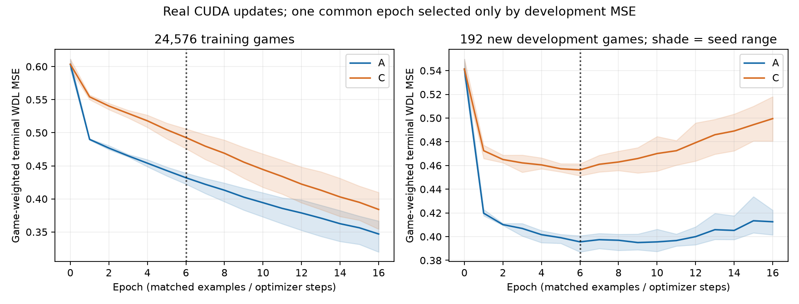
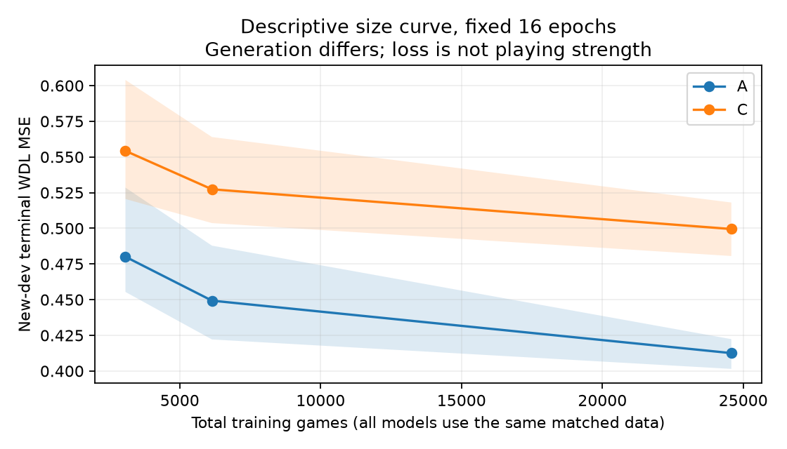
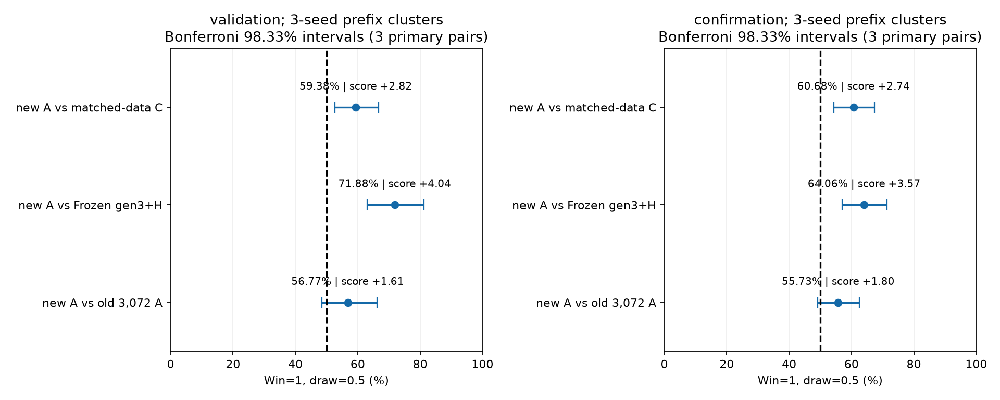

# GPU生成から24,576局の実学習・新対戦まで

**追加学習と必要な性能評価を実行完了。採用gate：未達。** main・Frozen gen3・公開Webは変更していません。

検証済みasync512を使って新18,432訓練局と別192開発局を生成し、既存6,144訓練局と合わせた24,576局でA/C各3seedを元gen3から実際にCUDA更新しました。旧モデルのload/exportだけではありません。勝点は勝ち1、引分0.5。新32prefixの独立確認まで実施しました。

## 固定条件と学習の事実

- [PLAN](PLAN.md)は生成・学習・新対戦結果より前のcommit `f858953`。train/dev bank固定は`38ad89f`。途中の担当AI capacity失敗時も外部生成は継続し、待機監督だけ引き継ぎました（handoff.json）。
- 教師：Frozen gen3の3seed、幅4・完成6ply。A教師への変更なし。各game独立RNG、既存速度bank/評価bank/人間棋譜は学習へ転用なし。
- 学習方策は別の元gen3として凍結。valueコピーのみ更新。Aは合法配置の252特徴を追加、Cは従来構造。同一データ・同順序・同更新予算。真の終局WDL MSE＋元valueからの逸脱抑制0.1、Adam1e-4、batch64、float32。
- 訓練局面数：**673,764**（旧168,427＋新505,337）、新開発局面5,241。全6モデルを各16epoch、各**168,448 optimizer updates**、合計**1,010,688 updates**を実行。
- A/C×全3seed平均の新dev MSEだけで共通**epoch 6**を選択。各公開研究exportは**63,168 updates**時点。対戦成績によるモデル/seed/epoch選別なし。最新16epochのAdam・CPU/CUDA/NumPy/Python RNGも別ファイルで保存。
- 既存6,144局はCPU500ms生成で完成深度が変わり得る一方、新規分はGPU完成6plyです。近い同点でGPU丸めによる着手差もあります。旧A16と新A6では実更新回数・checkpoint選択規則も異なります。したがって純粋なデータ数だけの因果効果、CPU/GPU bit同値とは呼びません。

量別図は旧3,072/6,144/新24,576局を固定16epochで同じ新devへ適用した記述的比較です。新devは選択用であり、棋力の独立証拠ではありません。

## 新しい対戦結果

全条件CPU native、torch1thread、core0、幅4/max6/500ms上限。学習・生成・重い監査と時間対戦を重ねていません。Q=旧成功3,072局A16、F=Frozen gen3+H、C=今回同量の従来構造。3seed固定、先後交換、prefixをクラスタとして20,000回bootstrap。通常95%区間と3主比較補正98.3333%区間を分け、旧試験やvalidationを確認標本へ合算していません。

新規ラベルの実手番・段階分布（学習対象は8ply以降。終局までの全対象局面を保持し、席別水増しはしない）：

|split/手番|8–15ply|16–31ply|32ply以降|
|---|---:|---:|---:|
|train/0|73,728|147,019|36,675|
|train/1|73,728|146,302|27,885|
|dev/0|768|1,534|369|
|dev/1|768|1,528|274|

### validation

|比較|勝–分–敗|勝点率|通常95% CI|3比較補正CI|得点差（95% CI）|
|---|---:|---:|---:|---:|---:|
|AQ|52–5–39|56.77%|49.48–64.06%|48.44–66.15%|+1.61（+0.53–+2.62）|
|AF|66–6–24|71.88%|64.58–79.69%|63.02–81.25%|+4.04（+2.52–+5.59）|
|AC|55–4–37|59.38%|53.65–65.10%|52.60–66.67%|+2.82（+2.16–+3.56）|

### confirmation

|比較|勝–分–敗|勝点率|通常95% CI|3比較補正CI|得点差（95% CI）|
|---|---:|---:|---:|---:|---:|
|AQ|104–6–82|55.73%|50.52–61.20%|49.22–62.50%|+1.80（+0.74–+2.78）|
|AF|122–2–68|64.06%|58.33–70.05%|57.03–71.35%|+3.57（+2.57–+4.60）|
|AC|112–9–71|60.68%|55.47–66.15%|54.43–67.45%|+2.74（+1.90–+3.58）|

Frozen gen3+Hおよび同量Cへの勝点改善は補正CIでも確認できました。一方、旧3,072局Aへの上積みは補正下限49.22%で未確定です。通常95% CIは50.52–61.20%ですが、事前の3比較補正を優先し、全比較採用gateは未達のままです。旧Aの差し替えを推奨する確証とはしません。

seed別・先後別値、得点差補正CIは各summary JSONに保存しています。標本を途中追加せず、全seedを保持しました。人間への強さは未検証です。

### 実時間と探索

|比較/手法|平均ms|最大ms|p95ms|p99ms|6ply完成率|550ms超過率|fallback数|
|---|---:|---:|---:|---:|---:|---:|---:|
|AQ/A|184.78|500.22|390.94|454.31|99.86%|0.000%|0|
|AQ/Q|192.58|500.23|392.78|458.07|99.60%|0.000%|0|
|AF/A|180.03|500.16|383.56|456.07|99.86%|0.000%|0|
|AF/F|132.60|352.86|259.68|299.65|100.00%|0.000%|0|
|AC/A|182.16|500.21|391.08|448.90|99.86%|0.000%|0|
|AC/C|132.95|363.35|265.22|311.36|100.00%|0.000%|0|

表のfallbackは完成探索がなく方策greedyへ戻った回数です。6ply未完で完成4plyを保持した着手は完成率に反映されます。
同じ500ms上限でも実消費時間は同じではありません。cold/warm準備費用は各phase-time.jsonに分離。完了段階だけ採用し、深く読めたことだけを棋力改善とはしていません。

## 費用

- 新18,624局生成（開発含む）：外側wall **55.77分**、内部初期化6.16秒、内部定常＋fill/tail 55.59分。再測定の速度比較ではなく本データ生成の費用です。
- 生成GPU利用率 平均49.4%/中央値51.0%、外部観測VRAM最大2658MiB、Torch peak1233.1MiB。外部GPU利用率にはデスクトップ等も含まれます。
- 同時対局slot上限512に対し実NN batch平均44.99、候補padding/実候補比8.01倍。512を実NN batch数とは呼びません。
- 生成worker/coordinator CPU累積26842.3秒（初期化のCPU秒を含まない）。実batch/queue/transfer/capture/occupancyはgames/timing.json、毎秒telemetryに記録。
- 独立再生＋特徴生成：1.02分。
- 6モデル実CUDA学習：**20.71分**、Torch peak2937.8MiB。epoch/update数はlearning-*.json、GPU観測はtraining-telemetry.json。
- validation時間対戦：19.68分（warmup内訳別記）。
- confirmation時間対戦：36.44分（warmup内訳別記）。

## 検証・再現・限界

- 新18,624局は全て独立座標checkerで合法性・強制pass・終局+15/+20を再生し、実手番WDL・完成6ply・RNG/game識別・元Frozen SHAを監査。学習ラベルは8ply prefix後の局面。初期空盤面など共有されるprefix途中状態と採用評価開始/学習対象状態は区別。
- 新train/dev、過去評価/速度bank、元PPO訓練index、今回対戦の実訪問状態を照合。新対戦全棋譜・得点・勝点・CIを再計算（audit.json）。旧6,144局の過去監査と元履歴はSHA参照で保持。
- 代表seed1751401のA/CについてCPU/CUDA別processで連続3epochと1＋再開2epochの重み・Adam・全RNGがbit一致。最新の実学習checkpointからも検査。A/C初期予測一致と実重み変更、凍結policy保持を確認。
- 新exportのCPU/CUDA値は事前絶対許容差2e-5以内。合法手と完成木を確認。生成全軌跡のCPU/GPU bit一致を意味しません。
- クリーンGit checkoutでCUDAを隠し、127 tests PASS・6 skippedと全6exportのCPU対局、人間先後CLIを実行・独立再生。既存CUDA-capable torch wheelをCUDA非表示で利用しており、CPU専用wheelの新規導入試験とは区別。
- 元gen3コード/重みを上書きせず、推論exportとAdam/RNG再開checkpointを区別。mainへのmerge/deployなし。

[再現コマンドと履歴不要CPU CLI](REPRODUCE.md)。新棋譜はgame-archivesの小分けアーカイブ、同一byteのmanifest付き。旧巨大履歴は複製していません。

今回の結果は、この固定3seed・評価分布・探索条件での結果です。一般的な強さの上限や学習不可能を示すものでもありません。結果が改善を示さない場合、固定幅4の元policyが作る継続分布、WDL回帰と探索時の選択損失の差、データ分布変化が残る仮説です。この試験内で教師・幅・loss・LRを救済変更することはしませんでした。
