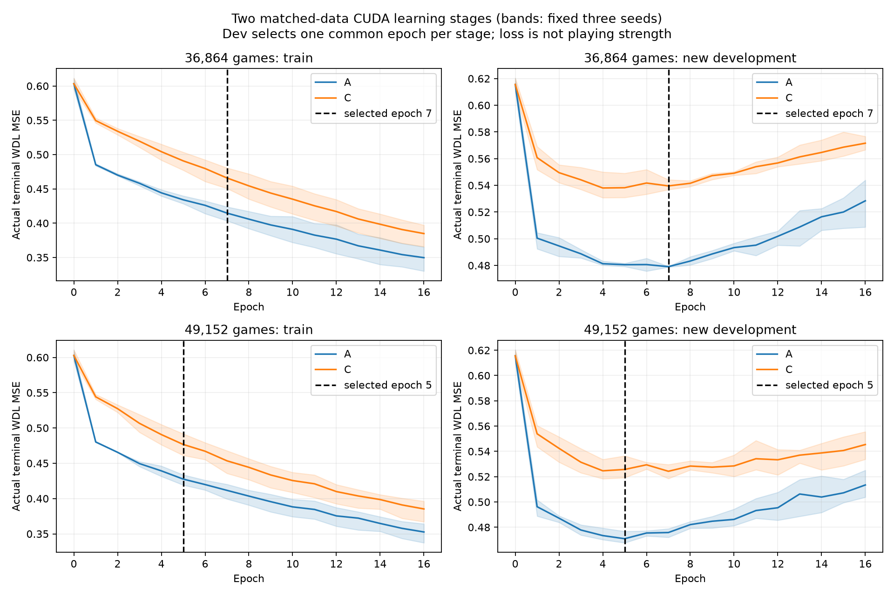
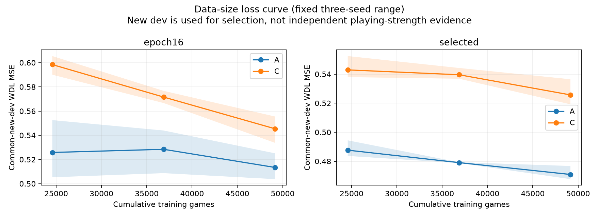
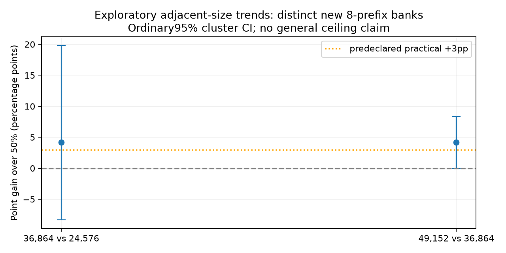
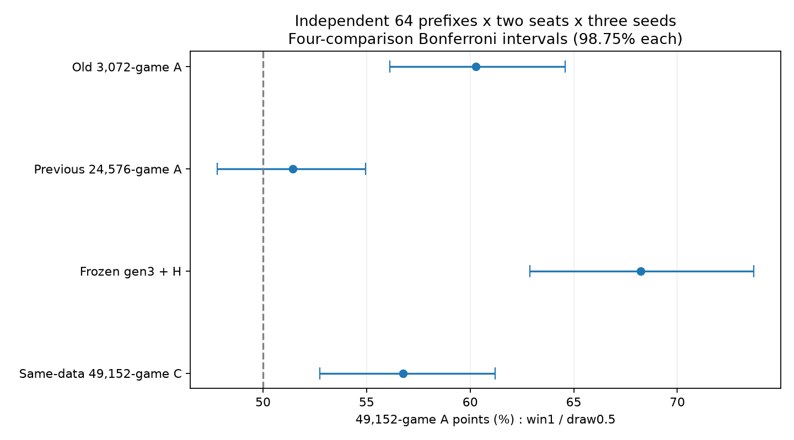

# 49,152局までの追加データ学習と独立確認

**GPU生成・2段階の実CUDA学習・新1,728局の対戦・監査を完了。採用gate：未達。** main/Frozen gen3/Webは不変。新規24,576訓練局と192dev局を生成し、旧24,576訓練局のみへ追加しました。旧評価/速度bankや旧devを訓練へ転用していません。勝点は勝1・引分0.5。

5時間枠の事前PLANは`cdd2210`、新bankは`3701319`。段階36,864/49,152、各A/C全3seed、各16epochを事前固定。最終候補は対戦成績を見ず49,152局版Aに固定しました。前回結果・gateの変更や救済スイープはありません。新しい学習/対戦成績を見る前の05:51UTCに費用再計算を行い、最終確認を32から64prefixへ事前増量（308abb5/a281390、PLAN内に旧案も記録）しました。結果を見て標本数を変更していません。

## 実際に更新した学習

教師は固定Frozen gen3幅4完成6ply、生成はasync512/batch128/8workers+coordinator。方策は別の元gen3で固定、価値コピーだけを更新。Aは252合法配置特徴追加、Cは元構造。両者同じゲーム/局面/順序/更新予算、Adam1e-4/batch64/float32、実終局WDLのgame正規化MSE＋元value逸脱抑制0.1。各段階は元gen3から新規開始し、旧学習済valueからの継続ではありません。

|累積訓練ゲーム|局面数|各モデル最大updates|6モデル計updates|dev選択共通epoch|選択時updates|CUDA学習wall分|
|---:|---:|---:|---:|---:|---:|---:|
|36,864|1,010,711|252,688|1,516,128|7|110,551|30.59|
|49,152|1,347,381|336,848|2,021,088|5|105,265|41.24|

全12モデル合計 **3,537,216 Adam更新**。各段階の6モデル平均新devMSE最小で共通epochを選択し、同点は早いepoch。新devは両段階で共用した選択データであり、独立棋力証拠ではありません。最大16epochのoptimizer/全RNGと全epoch推論exportを保持。

共通の新devで旧24,576/新36,864/新49,152を同じ入力で測った量別誤差はquantity-dev.jsonに保存。選択epochと固定epoch16を併記しますが、これは選択済みdevの記述比較であり追加のモデル選択や独立棋力証拠ではありません。

同じ新devでの選択済みAの平均MSEは24,576局0.48765→36,864局0.47908→49,152局0.47093。誤差は減りましたが、独立確認の49,152対24,576勝点51.43%は補正CIが50%をまたぎます。表現学習の改善と実対戦の上積みは同じものではありません。旧24,576のepochは別devで選んだため、この量別曲線にも選択条件差があります。

## 新しい段階比較（探索的）

CPU native1thread/core0、幅4/max6/500ms。各段階は別の新8prefix×先後×全3seed、2比較、96局。Pは直前量のA（36,864段階では24,576、49,152段階では36,864）、FはFrozen H。2比較補正97.5%CIと通常95%CI。ここで最終候補を差し替えていません。

### 36,864ゲーム段階

|比較|勝–分–敗|勝点|通常95%CI|family補正CI|得点差（通常95%CI）|
|---|---:|---:|---:|---:|---:|
|AP|24–4–20|54.17%|41.67–69.79%|40.62–71.88%|+1.23（-0.25–+2.65）|
|AF|32–0–16|66.67%|54.17–77.08%|52.08–79.17%|+4.56（+2.92–+6.23）|

### 49,152ゲーム段階

|比較|勝–分–敗|勝点|通常95%CI|family補正CI|得点差（通常95%CI）|
|---|---:|---:|---:|---:|---:|
|AP|25–2–21|54.17%|50.00–58.33%|50.00–59.38%|+0.29（-0.10–+0.77）|
|AF|31–1–16|65.62%|53.12–77.08%|52.08–78.12%|+3.73（+1.25–+6.21）|

事前の実用差+3ppに対して、両段階の95%CI上限が53%未満という伸び鈍化条件は **不成立**。点推定の上下や単発の非有意だけから上限・同等性を結論しません。

## 独立確認（最終判定）

事前固定の新64prefix×先後×3seed、各384局・計1,536局。Q=旧成功3,072局A16、R=前回24,576局A6、F=Frozen gen3+H、C=今回49,152局C。同一prefix内の先後/seed相関を保った20,000回bootstrap、4比較Bonferroni98.75%区間。段階試験や旧確認は合算していません。

|比較|勝–分–敗|勝点|通常95%CI|family補正CI|得点差（通常95%CI）|
|---|---:|---:|---:|---:|---:|
|AQ|225–13–146|60.29%|57.03–63.67%|56.12–64.58%|+2.10（+1.53–+2.67）|
|AR|189–17–178|51.43%|48.57–54.30%|47.79–54.95%|+0.23（-0.26–+0.72）|
|AF|254–16–114|68.23%|63.93–72.53%|62.89–73.70%|+3.82（+3.18–+4.48）|
|AC|211–14–159|56.77%|53.52–60.16%|52.73–61.20%|+1.86（+1.29–+2.47）|

seed別・先後別・seed×先後の記述集計と通常95%CIはn49152/confirmation-strata.json。これらの小集団順位でseedを選別せず、主判定は上記4比較の集約補正CIです。

- 旧3,072局A：補正下限56.12%。この評価分布での優越は確認。
- 前回24,576局A：補正下限47.79%。この評価分布での優越は未確認。
- Frozen H：補正下限62.89%。この評価分布での優越は確認。
- 同量C：補正下限52.73%。この評価分布での優越は確認。

**推奨：旧成功候補を維持します。全比較の事前採用条件は未達で、新モデルの自動採用は推奨しません。** 未確認は同等性や劣化の証明ではありません。人間への強さ・固定3seed以外への一般化は未検証。

### 実思考時間

|比較/手法|平均ms|最大ms|p95ms|p99ms|完成6ply率|550ms超過率|greedy fallback|
|---|---:|---:|---:|---:|---:|---:|---:|
|AQ/A|183.59|500.18|381.21|446.96|99.95%|0.000%|0|
|AQ/Q|194.66|500.22|393.15|461.56|99.73%|0.000%|0|
|AR/A|186.89|500.19|381.00|451.98|99.79%|0.000%|0|
|AR/R|187.41|500.12|383.70|442.14|99.86%|0.000%|0|
|AF/A|183.39|500.17|382.09|445.22|99.93%|0.000%|0|
|AF/F|136.48|363.22|262.04|299.56|100.00%|0.000%|0|
|AC/A|184.53|500.26|382.56|448.00|99.88%|0.000%|0|
|AC/C|130.48|396.85|263.92|306.93|100.00%|0.000%|0|

同じ500ms上限でも実消費wallは異なります。完成6ply未達時に完成4plyを保持した着手とgreedy fallbackを区別。warmup費用は各validation-time.json/confirmation-time.json、時間対戦と生成/学習/重監査は別工程です。

## 費用と予算

新24,768局生成wall **74.25分**、初期化6.31秒。GPU利用率平均49.7%、中央値51.0%、外部観測VRAM最大2650MiB（デスクトップ等の利用を含みます）。512同時slotは実NN batchと同じ意味ではありません。raw batch/queue/転送/pack/CPU秒はgames/timing.jsonに保持。独立特徴化1.36分。
- 36,864学習：外側30.61分、GPU利用率平均33.6%。段階対戦6.19分。
- 49,152学習：外側41.28分、GPU利用率平均33.1%。段階対戦6.63分。
- 最終確認：101.31分。

第三段階の新12,288局だけでも現在の実測生成速度では約37分を要し、追加学習と独立評価まで残り予算に収められません。余った時間を同じデータの追加epochに置換していません。追加第三段階・49,152局を超えるデータ・教師/構造変更・LR探索は実施していません。今回の有限5時間枠は2段階と独立確認・保存へ先に配分しました。旧6,144局のCPU500ms由来と追加GPU完成6plyの差、GPU近接tie丸め、旧A16とdev選択モデルの更新数/epoch差を保持しており、純粋な局数のみの因果効果やCPU/GPU bit同値とは呼びません。

## 解釈と次の判断

旧3,072候補への改善は今回新しく確認できた一方、24,576→49,152の追加利得は小さい点推定で未確定です。これは頭打ちを疑う材料ではあっても、事前の複数段階伸び鈍化基準は満たさず、固定教師/固定方策/この局面分布での上限も証明していません。方策を固定したまま価値予測だけを改善しても候補集合が変わらない制約や、教師の継続分布と最終探索の分布差は次の診断仮説です。今回その因果性を検証したとは主張せず、追加の教師/構造/方策実験は行っていません。

## 正しさと再現

全新生成24,768局を独立座標checkerで合法手/forcedpass/終局+15/+20/得点再生、実手番WDL・game重み・完成6plyを監査。既存train/dev/評価/速度bankと元PPOindexへの分離、新train/dev分離、3組の新評価実訪問状態の相互分離を確認。全1,728新対戦を独立再生し勝点・得点・CIを再計算。source/bank/code/model SHAと実更新数・epoch選択も再検算（audit.json）。初期空盤面など共通prefix途中と学習対象/評価開始は区別。

変更していない更新式とAdam/RNG復元は前回のCPU/CUDA別process bit一致検証を参照し、新ドライバは旧式のAST一致と累積shard/対照識別をテスト。今回実学習checkpointからのCPU/CUDA別process再開も確認。全12exportのCPU/native/PythonとCUDA値は事前許容差2e-5以内、実重み変化・policy保持・合法完成木を確認。クリーンGit checkout、CUDA非表示で関連回帰10pass/1skip・全6最終exportのCPU対局・人間先後CLI、全8棋譜の独立再生を確認。既存CUDA対応wheelを非表示で使用し、新CPU専用wheel導入とは区別。

途中の待機監督processがtool shell終了後に残らなかったため監督のみ復旧しました。GPU生成processは継続、二重生成/計算再実行なし（supervision.json）。AI担当runと外部計算障害を混同しません。

[再現コマンド](REPRODUCE.md)。旧巨大履歴を複製せずSHA参照、新棋譜だけbyte一致アーカイブ。推論exportは履歴/optimizer/index不要。全結果と失敗を研究branch/同PRへ保存、本番変更なし。
