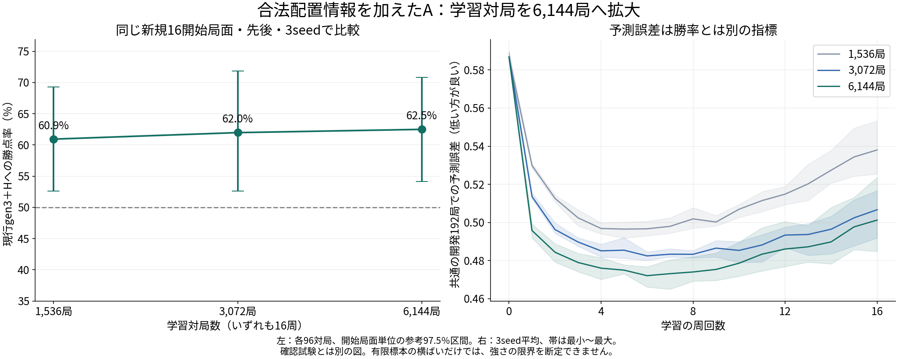

# A評価器：学習対局3,072→6,144局の追加検証

6,144局版Aの独立確認条件：**未達**。main・Frozen gen3・Webは変更していません。

今回の6,144局版は、現行gen3と同量再学習した従来構造には優位でしたが、前回の3,072局版Aへの上積みは確認できませんでした。増量版への差し替えは行わず、前回のAを候補として維持します。これは今回の記録に対する結論で、学習の一般的な限界の証明ではありません。

## 目的と固定条件

前回の少数prefixの段階比較だけでは勝率の頭打ちを判定できなかったため、[事前計画](PLAN.md)に従い、新規3,072局を追加しました。同じデータのepochだけを延長する試験ではありません。

学習は計6,144局・168,427局面、独立開発データ192局。A/C各3seed、各16epoch・42,112更新。前回と同じAdam1e-4、batch64、終局勝敗MSE＋元評価からの逸脱抑制0.1です。各モデルは元gen3から開始し、policyの候補順位は別の元gen3に固定。教師は元gen3＋Hのままで、学生自身による反復自己対戦ではありません。

- P：前回の1,536局版A16。
- Q：前回に独立確認を通った3,072局版A16。
- A：今回の6,144局版A16。駒別の現在の合法配置情報をvalueへ追加。
- C：同じ6,144局で従来のvalue構造を再学習。
- F：変更していないgen3＋H。

全て幅4、最大6ply、500ms上限。native CPU、torch1thread、core0に固定して逐次対戦し、学習・重い監査は重ねていません。全モデル・評価bankは対戦開始前に固定しました。

## 共通局面での勝率曲線と選択

新16prefix×両席×3seed、各96局・計576局です。P/Q/Aは同じ相手F・開始局面・先後・seedを共有しています。勝点率は勝ち1・引分0.5。次表の区間は参考97.5%prefix-bootstrap区間で、6比較全体の有意差判定には使いません。

|比較|勝–分–敗|勝点率|区間|平均得点差|
|---|---:|---:|---:|---:|
|PF|57–3–36|60.94%|52.60–69.27%|+2.20|
|QF|59–1–36|61.98%|52.60–71.88%|+2.31|
|AF|60–0–36|62.50%|54.17–70.83%|+2.76|
|AQ|47–6–43|52.08%|43.23–60.94%|+0.52|
|AC|60–5–31|65.10%|57.81–72.92%|+2.75|
|CF|46–4–46|50.00%|42.71–58.85%|+0.10|

同じprefixで対応を取った勝点率差（記述的な95%区間、prefixごとに両席・3seedをまとめ20,000回bootstrap）：

- QF-PF：差+1.04ポイント、95%区間-7.29～+9.38ポイント。
- AF-QF：差+0.52ポイント、95%区間-6.25～+7.81ポイント。

選択条件はA/FとA/Qの勝点率50%超かつ平均得点差正、A/Cは勝点率50%以上、全3比較でAの550ms超過率1%以下。結果は**通過**でした。誤差が広い場合、非有意を頭打ちの証明とはしません。

## 独立確認

事前条件未達。以下は別32prefix・各192局の独立確認。3主要比較の補正98.3333%区間です。

|比較|勝–分–敗|勝点率|区間|平均得点差|
|---|---:|---:|---:|---:|
|AF|115–7–70|61.72%|54.95–69.01%|+2.54|
|AQ|94–8–90|51.04%|46.35–55.73%|+0.46|
|AC|113–3–76|59.64%|54.43–65.10%|+2.69|

確認の採用条件はA/F、A/Q、A/Cすべてで補正区間下限50%超、平均得点差正、550ms超過率1%以下です。選択対局や前回の試験と合算していません。3,072局版の以前の成功結果は今回の追加試験によって取り消されるものではありません。

## 誤差と時間

共通開発192局に対する16epoch終点のMSE・3seed平均：A1536: 0.5380、A3072: 0.5067、A6144: 0.5012、C6144: 0.5813。各epochの曲線はlearning JSONに保存しています。予測誤差と棋力は区別します。6,144局版Aの平均開発誤差は6epochで最小になり、その後は上昇しました。同じデータをさらに周回することを、この曲線から勧める根拠は得られていません。

- AF：A平均188.1ms・6ply完了99.77%・550ms超過0.00%、F平均136.0ms・6ply完了100.00%・550ms超過0.00%
- AQ：A平均191.5ms・6ply完了99.76%・550ms超過0.00%、Q平均191.3ms・6ply完了99.71%・550ms超過0.00%
- AC：A平均187.8ms・6ply完了99.67%・550ms超過0.00%、C平均141.1ms・6ply完了100.00%・550ms超過0.00%

同じ時間上限でも実消費時間は異なります。有限の2倍増量試験で学習の限界・無限の伸びを証明するものではありません。データ増量とともに更新回数も増えています。ランダム8〜12手後からの比較であり、人間対戦・空盤面からの優越は未検証です。

## 保存と監査

新規生成は24.98分、6モデル学習は5.45分。対戦計測は74.28分です。

[監査](audit.json)：学習6,144局と評価対局を独立した座標集合実装で再生し、合法性・pass・終局得点・集計・訓練分離を確認。元訓練index、過去評価、今回train/devとの評価状態重複0。開始前のランダムprefixは訓練ラベルにしません。対称形や戦略的な類似を全て除いた意味ではありません。

[モデル検査](checks.json)：全6exportのCPU合法着手、policy不変、元モデル/data SHA、更新回数、CPU/CUDA別プロセスの実Adam/RNG保存再開を確認。棋譜・モデル・optimizer/RNG・事前計画を研究PRへ保存しています。[再現手順](README.md)。公開モデルの差し替えやサービス再起動は実施していません。
