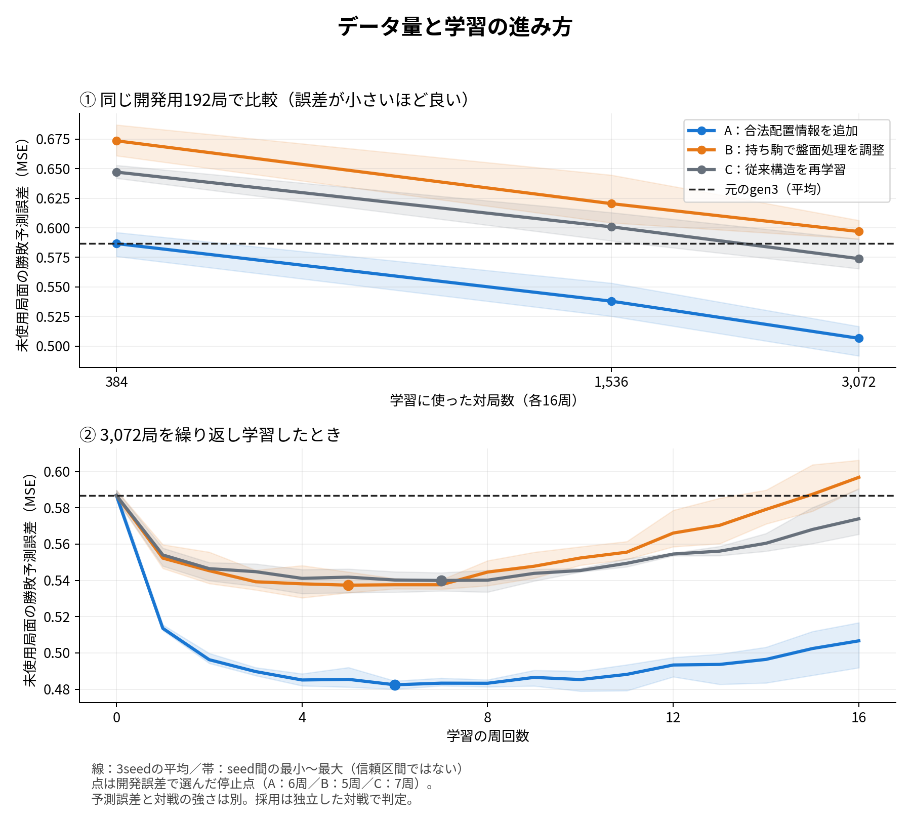

# 残り駒と盤面を結びつける評価NN：学習量拡大と独立確認

**学習用データを96局から3,072局へ増やし、固定16周版Aは独立確認で現行gen3＋深い先読みへの改善を確認しました。** 停止点選択版は事前条件未達でした。 新モデルのWeb公開やmainへのマージは行っていません。

このレポートは[前回の小規模実験](../value-placement-ab/REPORT.md)の追加検証です。元の不採用結果は保持しています。固定16周のデータ量比較と、後から開発誤差を根拠に追加した停止点選択比較は、別々の試験として報告します。

## 何を学習したか

- A：両者の残り駒それぞれの現在の合法配置有無・配置数・4領域の分布、計252特徴をvalueへ追加。
- B：持ち駒42次元で2つの畳み込み層をFiLM変調し、盤面圧縮前から持ち駒を反映。
- C：元のvalue構造を同じデータで再学習する対照。
- F：未変更のgen3＋H探索。候補幅4、最大6ply、500ms。

A/B/Cはvalue側の畳み込み・盤面圧縮・評価部を学習します。候補手を選ぶpolicyは別の元gen3のまま固定しています。A72,529、B57,777、C56,401パラメータで、容量を揃えた構造だけの因果比較ではありません。

新しい自己対戦3,264局を生成し、学習3,072局・開発192局に分けました。学習84,361局面（先手42,959、後手41,402）、開発5,253局面です。3つの元gen3を使い、ランダム8手の後は元のHで終局まで継続しています。人間棋譜は使っていません。学習目標は実終局の勝敗で、得点差や真のminimax値ではありません。

各モデルは元gen3から開始。Adam1e-4、batch64、ゲーム単位の重みを揃えたMSE＋元valueからの変化を抑える係数0.1。3seedとも同じ学習・開発データを使い、良いseedだけの選別はしていません。大きい段階は小さい段階のデータを含みます。異なるデータ量では更新回数も増えるため、データ量と更新回数を独立に分離した実験ではありません。

## データ量と予測誤差

すべて16周の終点。誤差は共通の開発192局に対するゲーム重み付きMSEの3seed平均です。元gen3の平均は **0.5869** です。

| 学習対局数 | 学習局面数 | 各モデルの更新回数 | A誤差 | B誤差 | C誤差 |
|---|---:|---:|---:|---:|---:|
| 384 | 10,514 | 2,640 | 0.5867 | 0.6735 | 0.6470 |
| 1,536 | 42,235 | 10,560 | 0.5380 | 0.6204 | 0.6008 |
| 3,072 | 84,361 | 21,104 | 0.5067 | 0.5968 | 0.5739 |

Aはデータ量を増やすと開発誤差が低下しました。一方、最大段階でも16周まで回すと、途中の最小誤差から上昇しています。**学習データを増やすことと、同じデータを長く回すことは別**です。予測誤差の改善だけでは棋力改善とは扱いません。

固定16周版Aの診断では、現在置けない残駒が10マス以上ある開発局面の誤差は元モデル0.4446から0.3200へ低下しました。2,347局面は同じ192ゲーム内で相関しており、独立標本数ではありません。この診断は採用判定に使っていません。

## 固定16周版：候補選択と独立確認

[事前計画](PLAN.md)をデータ生成前に保存しました。384局・1,536局段階は共通の6開始局面で各108対局の参考比較。最大段階は新16開始局面×両席×3seed、各96局で候補を選択しました。次表の区間は参考値で、5比較全体の有意差判定には使いません。採用の根拠は後続の独立確認です。

| 比較 | 勝–分–敗 | 勝点率 | 補正区間 | 平均得点差 |
|---|---:|---:|---:|---:|
| A / F | 61–4–31 | 65.62% | 57.81–73.96% | +2.60 |
| B / F | 44–0–52 | 45.83% | 37.50–53.12% | -0.78 |
| C / F | 41–8–47 | 46.88% | 38.02–55.21% | +0.30 |
| A / C | 56–1–39 | 58.85% | 51.04–67.19% | +2.80 |
| B / C | 38–3–55 | 41.15% | 32.81–48.96% | -1.21 |

Aが選択条件を通過したため、新32開始局面でA/F、A/Cを各192局、計384局の独立確認を実施しました。以下はこの確認だけの結果で、上の選択用対戦や過去実験とは合算していません。勝点率は勝ち1・引分0.5。開始局面ごとに両席・3seedをまとめて20,000回bootstrapし、2主要比較を補正した97.5%区間です。

| 比較 | 勝–分–敗 | 勝点率 | 補正区間 | 平均得点差 |
|---|---:|---:|---:|---:|
| A / F | 116–4–72 | 61.46% | 56.25–66.93% | +2.33 |
| A / C | 106–8–78 | 57.29% | 51.30–63.54% | +1.72 |

A/Fの平均得点差の区間は+1.47～+3.20、A/Cは+0.73～+2.68でした。両比較の勝点率下限が50%を超え、正の得点差・遅延条件も満たしたため、**固定16周版Aは事前条件達成**です。

| 比較・手法 | 非pass平均ms | 最大ms | 6ply完了率 | 550ms超過率 | 方策fallback |
|---|---:|---:|---:|---:|---:|
| AF・A | 189.3 | 503.4 | 99.67% | 0.00% | 0 |
| AF・F | 134.2 | 365.4 | 100.00% | 0.00% | 0 |
| AC・A | 188.3 | 500.3 | 99.63% | 0.00% | 0 |
| AC・C | 139.1 | 375.1 | 100.00% | 0.00% | 0 |

同じ500ms上限ですが、Aは実際の計算時間を多く使っています。同じ実消費時間での優越を示す試験ではありません。6plyを完了できない場合は完成済み4plyへ戻し、未完成の探索値は使いません。

## 開発誤差で停止点を選んだ追加比較

16周の終点で過学習が見えたため、固定版のvalidation進行中・対戦成績を参照する前に、[別の追加計画](EARLYSTOP_PLAN.md)を保存しました。固定版の結果や確認は置き換えていません。

各構造で「3seed平均の開発MSEが最小のepoch、同点なら早い方」という共通ルールで、A6周・B5周・C7周を選択しました。モデルごとに有利なseedを選んだものではありません。元重みから同じ更新列を再実行し、記録済みepochの訓練・開発MSEは全9モデルで差0でした。

| 構造 | 停止epoch | 各モデルの更新回数 | 開発MSE・3seed平均 |
|---|---:|---:|---:|
| A | 6 | 7,914 | 0.4824 |
| B | 5 | 6,595 | 0.5374 |
| C | 7 | 9,233 | 0.5400 |

停止点の選択に使った開発データは、以下の対戦開始局面と分離しています。過去・今回の訓練/開発・元の選択/確認対戦の訪問状態を除外した、さらに新しい32開始局面×両席×3seedです。各比較192局、計960局を実行しました。

主要比較はA/F、A/C、B/F、B/Cの4つ。開始局面単位のbootstrapで4比較を補正した98.75%区間です。C/Fは参考対照で、後付けの採用候補にはしていません。

| 比較 | 勝–分–敗 | 勝点率 | 補正区間 | 平均得点差 |
|---|---:|---:|---:|---:|
| A / F | 118–5–69 | 62.76% | 56.77–69.27% | +3.22 |
| B / F | 95–7–90 | 51.30% | 44.79–58.07% | +0.47 |
| C / F | 86–7–99 | 46.61% | 40.36–53.39% | +0.06 |
| A / C | 109–5–78 | 58.07% | 49.74–66.15% | +2.15 |
| B / C | 95–6–91 | 51.04% | 45.83–56.25% | +0.33 |

停止点選択版は事前条件未達でした。 判定は各候補のF/C両方で勝点率下限50%超、正の平均得点差、非passの550ms超過率1%以下です。追加の救済調整や標本追加はしていません。

固定16周版と停止点選択版は異なる独立bankを使っています。A16対A6の直接対戦ではないため、両表の数値差を停止時点だけの効果として断定できません。小さい段階の参考対戦も、開始局面が6つのみなので、学習量ごとの勝点差は記述的な結果です。

| 比較・手法 | 非pass平均ms | 最大ms | 6ply完了率 | 550ms超過率 | 方策fallback |
|---|---:|---:|---:|---:|---:|
| AF・A | 181.1 | 500.3 | 99.55% | 0.00% | 0 |
| AF・F | 132.0 | 404.8 | 100.00% | 0.00% | 0 |
| BF・B | 144.7 | 428.2 | 100.00% | 0.00% | 0 |
| BF・F | 129.4 | 437.9 | 100.00% | 0.00% | 0 |
| CF・C | 133.0 | 393.9 | 100.00% | 0.00% | 0 |
| CF・F | 129.0 | 403.9 | 100.00% | 0.00% | 0 |
| AC・A | 184.2 | 500.4 | 99.45% | 0.00% | 0 |
| AC・C | 136.2 | 429.1 | 100.00% | 0.00% | 0 |
| BC・B | 145.7 | 457.4 | 100.00% | 0.00% | 0 |
| BC・C | 134.6 | 395.0 | 100.00% | 0.00% | 0 |

## 検証と計算量

- 固定16周版の生成・評価4,344対局＋追加960対局、**合計5,304対局記録**を独立した座標集合実装で再生。合法性・強制pass・終局得点・算術を確認。
- 元gen3の訓練訪問状態27,533,566件との検査対象状態の重複0。学習/開発、試験群間、追加比較と過去・今回の訪問状態の重複検査もPASS。2つの小規模curve段階は計画どおり同じbankを共有しています。空盤面付近のランダムprefix過程は採用局面から除外しています。
- これは状態hashでの分離であり、対称形や戦略的に似た局面が一切ないという意味ではありません。
- 新clone CPUテスト110成功・5skip。固定版27export、追加9exportのCPU読み出し・合法着手・元policy不変を確認。実保存Adam/RNGのCPU/CUDA別プロセス再開を確認（137局面fixtureで6周継続と2周＋復元＋4周の一致）。追加9モデルは新cloneのCPU経路でも確認済み。
- 生成：27.10分（8物理コアへ固定）。特徴準備：11.74秒。固定版27モデル学習：7.21分。停止点選択版9モデルの再現：1.61分。
- 固定版の段階比較・validation・confirmation計1,080局：63.70分。停止点選択版960局：53.99分。対戦はCPU core0、torch1thread、native、逐次実行。学習・監査負荷を対戦中には重ねていません。思考時間はウォームアップ後の非pass着手を集計しています。

[元試験の全監査](audit.json)、[追加試験の監査](earlystop/audit.json)、学習曲線・全棋譜・保存モデル・optimizer/RNG・ファイルSHAはこのディレクトリにあります。[再現手順](README.md)。固定版モデル/bankを固定したcommitはd80fe52、追加計画はd81ef80、追加モデル/bank固定は71c0bf1です。

## 適用範囲

元の候補policy上位4手、最大6ply、同じ500ms上限、3つの元gen3モデル、新しい合法ランダムprefixからの対戦での結果です。空盤面からの人間対戦での優越や、あらゆる対戦相手への優越を示していません。

Aは現在の合法配置情報を明示できますが、将来その置き場を確保できることまでは保証しません。A/Bのパラメータ数は異なり、停止点選択版では更新回数も異なります。結果から「81次元の圧縮だけが弱さの唯一の原因だった」とは断定できません。

**main・公開設定・Frozen gen3の重みとタグは維持しています。新しい候補は研究用PRで保存した段階で、Webへの反映は未実施です。**
